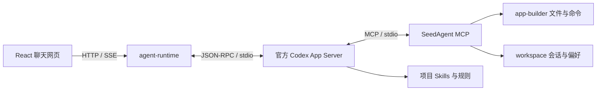

# SaplingAgent · SeedAgent

从一个聊天页面开始，通过与 AI 对话创建和修改自己的本地应用。

SaplingAgent 是仓库名；当前代码、启动脚本和运行时使用 **SeedAgent** 名称。前端采用 React 与 assistant-ui，模型、对话线程和工具执行由官方 **Codex App Server** 驱动。应用源码、会话、Skills、规则和运行环境都归属本地项目文件夹。

**当前支持 macOS 13.5+，自动识别 Apple Silicon / Intel。** 仓库仅保留三个分支：`main` 为纯 AI 聊天与应用构建起点，包含 macOS 安装器；`testcode` 保存用户测试的演进页面；`release` 为客户使用版本，目前与 `main` 完全一致。

## 快速开始：安装 → 登录 → 启动

### 1. 获取项目

有 Git 的用户可执行：

```bash
git clone --branch main https://github.com/extendmachine/Saplingagent.git
cd Saplingagent
```

也可在本仓库首页选择 **Code → Download ZIP**，解压到可写文件夹。通过 GitHub 下载需要具有仓库读取权限。安装不要求预装 Node、npm、Codex 桌面 App、Homebrew 或 Xcode；Git clone 路径需要 Git，ZIP 路径不需要 Git。

### 2. 安装本地运行环境

双击 **`1-安装.command`**，或在项目目录运行：

```bash
bash "1-安装.command"
```

脚本联网下载官方 Node **24.21.0**，核对官方 SHA-256，安装项目内 Codex CLI **0.146.1**，再按各模块锁文件安装依赖。固定版本在 [config/macos.json](config/macos.json)。所有运行环境写入 `.runtime/`，依赖写入对应模块 `node_modules/`，npm 缓存在 `.cache/npm/`。无需 `sudo` 或全局 npm 安装。

安装完成会显示“安装完成”；再次运行会检查版本并跳过已完成的安装。请保留整个项目文件夹，四个 `.command` 入口需要随附源码和配置。

### 3. 用自己的 Codex 账号登录

双击 **`2-登录Codex.command`**，或执行：

```bash
bash "2-登录Codex.command"
```

官方 Codex 会打开浏览器，使用你自己的 ChatGPT/Codex 账号完成登录。账号须具备相应 Codex 使用资格；实际可用模型、网络与额度以你的账号和真实请求为准。[官方登录说明](https://learn.chatgpt.com/docs/auth)

项目登录保存在 `local-secrets/codex/`，该目录同时作为本应用的 `CODEX_HOME`。安装器默认不复制全局 `~/.codex` 的登录资料，也不会改变你其他项目的账号。使用此默认登录路径无需填写 OpenAI API key。**不要向他人发送 `auth.json`、token 或整个 `local-secrets/`。**

浏览器回调无法完成时，可按官方设备码提示登录：

```bash
bash "2-登录Codex.command" --device-auth
```

设备码登录是否可用取决于账号/组织设置。已保存登录方式不代表当前网络、额度或模型请求一定可用。

### 4. 启动网页

双击 **`3-启动SeedAgent.command`**，或执行：

```bash
bash "3-启动SeedAgent.command"
```

脚本启动本地服务、接入 Codex App Server，等待账号、模型、MCP 与网页就绪，再打开 **http://127.0.0.1:5173/**。终端应显示：

```text
已接入 Codex App Server：<当前模型>；MCP 15 个；Skills 3 个。
```

在网页发送“你好”验证流式回复，也可要求“列出本项目的 Skills，不修改任何文件”。启动终端需保持开启；按 **Control+C** 停止本次服务。只启动、不自动打开浏览器：

```bash
bash "3-启动SeedAgent.command" --no-open
```

初始页面只有聊天入口。后续可以直接说“添加一个待办组件”“调整页面布局”或“为这个功能创建后端服务”，由 AI 按项目规则实施。

## 如何接入 Codex App Server

**正常使用只需上述安装、登录和启动三步。** 项目后端已经实现 App Server 客户端，不需要用户手动向 Codex 桌面 App 添加 MCP 或启动一个远程服务器。



### 项目已经替用户完成的接入

1. [scripts/macos/codex.sh](scripts/macos/codex.sh) 使用项目内 Node、官方 Codex CLI 和项目 `CODEX_HOME`，统一使用文件凭据存储。
2. [backend/agent-runtime/rpc.mjs](backend/agent-runtime/rpc.mjs) 启动 `codex app-server --listen stdio://`，通过 stdin/stdout 收发逐行 JSON。
3. [backend/agent-runtime/server.mjs](backend/agent-runtime/server.mjs) 发送 `initialize`，成功后发送 `initialized`；检查 `account/read` 与 `model/list`，创建/恢复 thread，发送 `turn/start`，把增量回复与工具事件转成网页 SSE。
4. 启动参数自动配置 `mcp_servers.seedagent`，运行 [backend/mcp-runtime/server.mjs](backend/mcp-runtime/server.mjs)，传入本项目路径和本地服务连接信息。当前有 **15 个 MCP 工具**；正常用户无需编辑全局 Codex 配置。
5. 从 [.agents/skills/](.agents/skills/) 发现 **seed-page-edit、seed-research、seed-skill-author**；AI 从 `AGENTS.md` 进入完整 `rules/` 规范。

App Server 使用 JSON-RPC 请求与通知，stdio 是逐行 JSON；初始化、线程和事件顺序按 [OpenAI 官方 App Server 文档](https://learn.chatgpt.com/docs/app-server) 实现。

### 开发者调试入口

安装完成后，可验证项目 CLI 与本项目登录状态：

```bash
bash scripts/macos/codex.sh --version
bash scripts/macos/codex.sh login status
```

仅调试底层协议时，启动一个独立 App Server：

```bash
bash scripts/macos/codex.sh app-server --listen stdio://
```

该入口等待 JSON-RPC 输入。以下是最小初始化顺序示意：先发送第一行，等待其成功响应，再发送第二行和后续请求。

```json
{"id":1,"method":"initialize","params":{"clientInfo":{"name":"seedagent","title":"SeedAgent","version":"0.1.0"},"capabilities":{"experimentalApi":true}}}
{"method":"initialized","params":{}}
{"id":2,"method":"account/read","params":{"refreshToken":false}}
```

完整网页、项目 MCP、Skills 和会话管理应使用 `3-启动SeedAgent.command`；独立协议入口不包含 agent-runtime 生成的项目 MCP 配置。正常运行时无需另开这个协议进程。

## 模型、权限与本地配置

运行配置在 [config/runtime.json](config/runtime.json)：

| 项目 | 当前默认值 | 说明 |
| --- | --- | --- |
| 首选模型 | `gpt-6.1-sol` | 按 App Server 返回的目录选择；首选不存在时使用目录默认/首项 |
| 推理强度 | `medium` | 实际请求还需满足所选模型支持范围 |
| 网页 | `5173` | 浏览器访问端口 |
| Agent | `4310` | 聊天、状态与流式事件 |
| Workspace | `4311` | 会话与偏好服务 |
| App Builder | `4312` | 文件、命令、快照服务 |
| 权限 | `full-access` | Codex `danger-full-access` / `approvalPolicy: never` |

配置中的模型名称是首选，终端和网页状态显示实际采用的模型。模型目录发现不等同于账号模型授权或额度验证，一次成功回复才验证该次请求。

当前 AI 可以使用原生工具与 MCP 修改前端、后端、MCP、Skills、配置和依赖，按当前 macOS 用户权限执行；没有 SeedAgent 目录白名单或逐次工具确认，不自动获得 root 或绕过 macOS 系统权限。快照提供部分文件的主动恢复能力；任意命令和原生写入的副作用不保证完整回退。

## 故障排查

先双击 **`4-诊断.command`** 或运行：

```bash
bash "4-诊断.command"
```

诊断报告安装、版本、已存登录和配置端口状态，不输出真实凭据，也不发起模型请求。

| 问题 | 处理 |
| --- | --- |
| 双击打不开、下载文件首次打开提示或执行位丢失 | 使用上方 `bash` 命令；首次打开按 macOS 的提示处理。安装脚本会恢复本项目入口执行位，不需要关闭系统安全功能 |
| 尚未登录 | 执行 `2-登录Codex.command`，完成自己的浏览器/设备码登录 |
| 登录过期或需要换账号 | 运行下面的项目注销命令，然后重新登录 |
| 下载失败或依赖损坏 | 检查到 Node 官网和 npm registry 的网络；用 `--repair` 重装，源码/认证/业务数据保留 |
| 另一轮安装正在进行 | 等原安装结束；若异常退出，确认没有本项目安装进程后，按安装指南处理项目安装锁 |
| 端口占用 | 关闭自己之前的启动终端，或修改 `config/runtime.json`；脚本不会杀其他项目进程 |
| 120 秒内未就绪 | 执行诊断并检查终端与 `logs/` 的服务元数据；核对安装、账号、网络和 MCP |
| 请求额度/账号授权错误 | 以官方账号和实际错误为准；重新安装不能增加额度或账号权限 |

```bash
# 修复本项目安装
bash "1-安装.command" --repair

# 退出本项目账号；保留源码和会话
bash scripts/macos/bootstrap.sh logout
```

移动应用前先停止服务，然后移动整个项目文件夹。相同架构下入口会重新计算路径；更换架构或依赖锁文件后重跑安装。详细说明：[macOS 安装指南](docs/macos-install.html)（下载后可用浏览器打开）。

## 目录与开发

```text
Saplingagent/
├── 1-安装.command / 2-登录Codex.command
├── 3-启动SeedAgent.command / 4-诊断.command
├── front/                     # React 与稳定聊天入口
├── backend/
│   ├── agent-runtime/         # Codex App Server 客户端与流式对话
│   ├── workspace/             # 本地会话、偏好和证据
│   ├── app-builder/           # 文件/命令与可选快照恢复
│   └── mcp-runtime/           # 项目 MCP 工具
├── .agents/skills/            # 三项项目 Skills
├── config/                    # 公开端口、模型和固定版本
├── scripts/                   # 安装、运行、打包与说明
├── rules/                     # 完整项目规范与受控附件
├── docs/                      # 人类 HTML 指南
├── local-secrets/             # 安装/登录后生成，Git 忽略
├── .runtime/                  # 项目 Node/Codex，Git 忽略
├── data/ / snapshots/ / logs/  # 本地运行资料，Git 忽略
└── AGENTS.md / FINAL_GOAL.md / TODO.md / AI_TASKS.md
```

AI 开发先读 [AGENTS.md](AGENTS.md)、[rules/README.md](rules/README.md) 与根状态文件；每项后端服务维护自己的 `SERVICE.md`、`CONTRACT.md`、`DEPLOY.md`、`REFERENCES.md`。执行工具、认证与本地环境的实现说明在 [scripts/macos/README.md](scripts/macos/README.md)。

## 分享应用与源码分支

GitHub 保存源码、完整 rules、Skills、锁文件和可追溯提交。真实认证、会话、日志、快照、安装环境及依赖不进入仓库；接收者安装并登录自己的账号。不要把运行中的项目文件夹直接整体压缩发给别人。

需要生成客户干净源包时，先在自己的 Git 仓库提交公开源码，再从项目目录运行安装后的项目 Node：

```bash
SEED_NODE_VERSION="$(/usr/bin/plutil -extract nodeVersion raw -o - config/macos.json)"
SEED_ARCH="$(/usr/bin/uname -m)"
if [ "$SEED_ARCH" = "x86_64" ]; then SEED_ARCH=x64; fi
".runtime/node-v${SEED_NODE_VERSION}-darwin-${SEED_ARCH}/bin/node" scripts/package-macos.mjs HEAD
```

源包默认写入 `.cache/releases/`，按指定 Git 提交提取公开文件，包含完整 rules、SHA-256 清单，初始化接收者目标/进度/任务。GitHub 的 Download ZIP 是源码快照；客户分发脚本生成的源包还会清理开发者任务状态。重新打包需要自己的 Git 仓库；下载 ZIP 后安装和运行不需要 Git。

| 分支 | 用途 |
| --- | --- |
| `main` | 默认首页：已测试的纯 AI 聊天起点、Mac 安装器与接入指南 |
| `testcode` | 当前已演进的页面，提交 `80cb9eb5` |
| `release` | 客户使用版本，目前与 `main` 指向同一提交 |

用户已完成交付版测试；安装器、退出清理与完整 README 已归入纯聊天版本。其余临时分支已按用户要求清理，来源提交保留在 Git 历史。客户可用 `git clone --branch release https://github.com/extendmachine/Saplingagent.git` 获取相同的当前版本。后续进入 `main`、发布到 `release` 的改动继续绑定实际测试记录。

## 当前验证与认证边界

安装候选已在 Apple Silicon macOS 上通过 **42 项测试、TypeScript/Vite 构建、真实全新目录安装、目录移动、实际模型回复/MCP 调用和 SIGHUP 后服务端口释放**。Intel 二进制与架构选择已核对，Intel 真机、Finder 首次双击和用户本人 OAuth 交互仍需对应环境验收。当前为本地开发源码应用，长期自动布局改善、云端服务、其他平台和签名原生 `.app` 尚未实现。

本项目目前采用官方 Codex 的本地用户自登录方式。OpenAI 官方允许已有本地或开源应用继续使用 App Server 认证，并要求商业或托管服务使用正式的 **Sign in with ChatGPT** 接入；本项目未完成该商业认证注册与集成。见 [App Server 认证边界](https://learn.chatgpt.com/docs/app-server#auth-endpoints) 和 [Sign in with ChatGPT 的 App Server 接入](https://developers.openai.com/siwc/token-sharing-open-source/codex-app-server)。

## 官方资料

接入信息最后核对：2026-10-09。

- [Codex CLI](https://learn.chatgpt.com/docs/codex/cli)：官方客户端与安装方式。
- [Codex App Server](https://learn.chatgpt.com/docs/app-server)：stdio、初始化、线程、流式事件和 MCP。
- [Codex Authentication](https://learn.chatgpt.com/docs/auth)：账号登录、文件凭据和设备码方式。
- [Node 24.21.0](https://nodejs.org/en/blog/release/v24.21.0)：本项目固定 Node 版本。
- [详细本地指南](docs/index.html)、[接口说明](docs/api-interfaces.html)、[运行说明](docs/runtime.html)。

## 项目规范分发指南

用户指定的公共规范保留在 `rules/`，AI 入口仍为 `AGENTS.md → rules/README.md`。下方保留最初引入的完整规范分发说明；它只用于明确要求引入/复制规范的任务，正常安装本应用不需要重新复制规范源。

<details>
<summary>展开完整项目规范分发指南</summary>

# AI 项目规范文件

这里存放一组用于规范 AI 执行项目任务的本地规则文件。

> **分发强制要求：** 用户要求引入或复制规范时，本文件夹整体就是项目模板。AI 必须将其中全部受控内容复制到用户指定的目标项目根目录，包括 `.gitignore`、入口文件、状态文件、`rules/`、`docs/`、`services/`、`logs/` 和 `local-secrets/` 安全骨架。公共规范同名文件直接覆盖，`rules/` 完整替换；已有项目的真实私密信息和真实日志不得被空骨架覆盖。

## 给后续 AI 的强制执行指令

先按用户要求确定任务类型，执行边界以 `rules/README.md` 为准：

- 只读审阅、检查或提出建议：读取目标项目的实际内容，输出发现和编辑建议，不复制、重构或更新状态文件。
- 引入或复制规范：按下面 12 步完成受控内容复制、必要初始化和检查；业务整改只在已授权范围内实施。
- 实施整改：根据用户已确认的建议或明确整改要求执行，不重复申请同一范围的授权。仅阅读本文件不构成任何写入授权。

以下为已授权规范分发的顺序。用户只要求某一阶段时，按该阶段交付并如实记录后续事项；不得声称未执行的整改或人工验收已完成。

1. **确认源目录和目标目录。** 源目录固定为 `/Users/xty/Desktop/projctworks/0.skills项目规范/`；目标目录必须是用户指定项目的根目录。开始前向用户报告两个绝对路径和预计处理范围，不得把源目录本身误当成目标项目修改。
2. **盘点目标项目现状。** 在覆盖前读取目标项目已有的入口文件、目标、todo、权威任务记录、目录结构、技术栈、Git 状态、微服务、接口、部署方式和项目专用说明。将覆盖后必须恢复的项目事实保存到不会被覆盖的项目内任务记录，仅保留事实和凭据路径；协调受覆盖影响的进行中任务，防止丢失有效认领和授权。
3. **保护目标项目本地数据。** 先识别并保留已有 `local-secrets/`、真实日志、数据库文件、环境目录、业务代码和其他本地数据。规范源中的空总账、空目录说明不得覆盖目标项目已填写的私密信息或真实日志；不得复制、展示或提交真实密钥。
4. **完整复制规范包。** 将本项目全部受控内容复制到目标项目根目录，按本 README 的清单直接覆盖同名公共规范文件。`rules/` 必须按源目录完整替换，不能选择性复制、差异合并、保留旧规则或新建第二套模板目录。
5. **从目标项目重新加载规范。** 先完成下方“复制阶段检查”，再从目标副本重新读取入口、规则和状态文件，按规则 14 定位权威任务索引。识别刚复制的模板历史并在第 8 步重建项目事实；后续执行以目标项目规则和持久化事实为依据。
6. **全面审视目标项目。** 基于真实代码和配置检查项目目标、目录边界、微服务职责、跨服务依赖、前后端接口、数据库、日志、环境、部署、敏感信息、Git 分支和人类文档。识别不符合规范的内容、缺失文件、耦合点、风险和待确认事项。
7. **先列出重构审视结果和修改计划。** 向用户给出按优先级排列的检查结果，明确计划修改的服务、目录、文件、原因、影响和验证方式。已授权的规范化工作可继续；涉及删除业务文件、移动大量代码、数据库迁移、覆盖真实数据或其他不可逆操作时，核对已有明确批准，没有对应批准则先确认。
8. **重建目标项目状态文件。** 根据目标项目实际内容和覆盖前保存的事实重建 `FINAL_GOAL.md`、`TODO.md` 和 `AI_TASKS.md`，清除本规范项目历史。恢复目标项目原有有效认领、协调者和授权记录，不能重置已有协调 Worktree 的实时状态；目标、进度、分支、Worktree 和验证状态必须真实可追溯。
9. **按微服务重新组织和补全项目。** 在已授权初始化或整改范围内，为实际服务补齐 `SERVICE.md`、`CONTRACT.md`、`DEPLOY.md`、`REFERENCES.md` 和 `ai-tasks/`；代码结构改造依第 7 步的授权范围实施，其余列为后续计划。一个层级一个模块服务一个目录，跨服务按接口或共享契约通信，不创建虚假服务。
10. **补全项目运行与安全管理。** 按授权范围配置服务日志、按天记录和普通日志 30 天保留，运行环境遵守规则 11；未授权的共享环境迁移等操作列为待确认项。私密信息只存入目标本地 `local-secrets/`，确认未被 Git 跟踪，不用空总账覆盖真实内容。
11. **同步人类审阅文档和 Git 管理。** 根据目标项目真实内容更新 `docs/index.html`、`docs/api-interfaces.html` 和 `docs/references.html`。修改必须进入对应微服务或特性分支，人工测试绑定具体提交；用户确认后才同步到 `main`，并记录来源分支、测试提交、任务编号和执行 AI。
12. **完成检查并提交回执。** 完成下方“初始化阶段检查”，核对当前授权阶段的结果。给出“规范包覆盖回执”和“结束复核回执”，区分实现、自检、人工验收和 main 同步，并列出未完成或未授权实施的后续事项。

规范分发完成须包含复制核对、规则加载、结构审视、项目事实重建和当前授权范围内的初始化复核。用户只要求审阅时，以审阅报告为交付，不执行上述写入步骤。

公共控制规范和规则索引统一放在 `rules/README.md`。根目录 `AGENTS.md` 是轻量启动入口，Claude Code 通过 `CLAUDE.md` 导入该入口，再继续读取同一份规则中心。

- 微服务架构组织
- Git 提交前筛选
- 日志目录规范
- Git 分支、人工测试确认、main 同步与来源版本标记规范
- 本地敏感信息文件夹安全规范
- 最终目标、当前进度 todo 与 docs/html 说明文件规范
- 微服务契约、服务说明、依赖、错误日志、人工验证、部署回滚规范
- 项目内环境隔离、Python venv、Docker 项目内配置规范
- 前后端接口人工审阅文档、接口名称与内容维护规范
- Codex 与 Claude Code 共用规则源、任务认领、Worktree 和交接规范
- 第三方平台官方网址、公钥证书入口和资料来源追溯规范
- 整目录项目底座，以及内置在各规则中的微服务、私密信息、日志、环境和交接填写格式
- Clawtask conversation v2.0 项目打包、附件工具、验证和平台交付流程

使用时，Codex 和其他兼容工具从 `AGENTS.md` 进入；Claude Code 从 `CLAUDE.md` 进入并导入 `AGENTS.md`。两个入口都必须指向 `rules/README.md`，不要在入口文件中复制完整公共规则。

`AGENTS.md` 的“项目专用补充”区域可以由 AI 按项目实际情况维护，从而保留 Codex 等工具需要的短提示；公共控制规范、规则索引和详细要求必须维护在 `rules/` 内，避免入口上下文过长。

AI 按规则索引完成读取和最小登记后，首次实质性修改前给出规范读取回执；结束或提交前给出结束复核回执。回执不需要等待用户回复；只读任务无需写入登记和状态文件。

本规范按用户习惯设计：每个项目必须有 `FINAL_GOAL.md`、`TODO.md` 和 `AI_TASKS.md`，AI 每次修改前都要先阅读它们。

`docs/` 内的 HTML 文件主要给人预览，AI 执行任务时应优先读取根目录目标、todo 和微服务目录内的 Markdown 说明。

每个目标项目的 `docs/api-interfaces.html` 用于人工审阅前后端接口。AI 修改接口时，应以微服务内的 `CONTRACT.md` 为执行依据，并同步维护这份 HTML 审阅文档。

Git 工作由 AI 纳管微服务分支和特性分支。AI 完成修改并提交到对应分支后，应把分支名称、待测试提交编号和测试步骤交给用户；用户确认该版本测试通过后，再由 AI 同步到 `main`，并在合并记录中注明来源分支和已测试提交。用户主要管理和使用 `main`。

协调者在目标项目的权威 `TODO.md` 中维护 Git 分支管理清单，区分已记录提交、冻结待测提交和 main 合并版本。冻结后的记录更新进入未冻结协调分支，不改变已交付的待测版本；进入 main 的记录快照也需人工审阅。

多个 AI 或多个对话并行工作时，由协调者在规则 14 指定的 `.worktrees/coordination/AI_TASKS.md` 登记，各任务使用独立分支和 Worktree。执行 AI 在各自服务 `ai-tasks/<task-id>.md` 中保存进度；普通 Worktree 的根索引只是快照。非 Git 项目使用根目录权威索引，重叠修改串行。

涉及第三方平台、API、SDK、公钥、证书或控制台时，AI 必须提供实际核对过的官方网址，在微服务 `REFERENCES.md` 中保存来源，并同步到 `docs/references.html` 供人审阅。

实际私密信息总账固定为目标项目本地的 `local-secrets/notes/project-secrets.json`。总账和分类凭据格式直接维护在 `rules/05-local-secrets-security.md`，规范包中不存放真实私密信息。

规范源已经预建 `services/`、`logs/` 和 `local-secrets/`。其中只包含目录说明和空总账，方便新项目整目录复制后直接填写；不得在本规范源中写入任何真实服务日志或真实凭据。

用户说“请将项目打包为 clawtask 可用”“生成 Clawtask 导入包”等同义要求，或修改 Clawtask 部署方案时，AI 必须按 `rules/17-clawtask-project-packaging.md` 执行。每次相关修改前先读取 `/Users/xty/Desktop/projctworks/5.clawtask/tools/skills/clawtask-package/assets/demo/` 的最新内容，并核对来源 Skill、契约与本项目 `rules/clawtask-package-skill-v2.zip` 的差异。默认生成 conversation v2.0 群聊项目包；附件是固定版本的打包工具，不是最新 Demo 的实时镜像，也不是可直接上传的业务包，无需全局安装 Skill。

Clawtask 交付项目有网页界面时，必须按规则 17 在实际网页底部加入 [Deployed with Clawtask ↗](https://clawtask.fun/)，并核对交付包及实际展示；不能仅在说明文件中放置链接。

## 分发到其他项目的强制方式

本文件是规范包分发指导文件。AI 收到“将项目规范引入目标项目”的任务后，必须读取本文件，并将本文件夹中的全部受控内容复制到目标项目根目录。复制采用直接覆盖方式，不采用挑选复制、差异合并或保留目标项目旧版规范的方式。

源规范目录：

```text
/Users/xty/Desktop/projctworks/0.skills项目规范/
```

`logs/` 和 `local-secrets/` 按安全规则被 `.gitignore` 忽略，因此必须从本地规范目录执行整目录复制；不能依赖 Git 提交或 Git clone 自动携带这两个目录骨架。

目标目录必须是用户指定项目的根目录。复制操作只覆盖源规范包中存在的同名文件或目录，不删除目标项目中无同名关系的业务代码、资源和其他项目文件。

## 必须复制并覆盖的内容

以下内容只是当前规范包的主要清单，不是可选清单。源规范目录以后新增的受控规范文件也必须一并复制：

```text
.gitignore
AGENTS.md
CLAUDE.md
README.md
FINAL_GOAL.md
TODO.md
AI_TASKS.md
rules/                  # 必须整目录镜像替换
docs/                   # 源文件全部复制并覆盖同名文件
services/               # 微服务根目录说明和后续服务目录位置
logs/                   # 日志根目录安全空骨架
local-secrets/           # 私密信息分类目录、安全说明和空总账
```

`rules/17-clawtask-project-packaging.md` 与 `rules/clawtask-package-skill-v2.zip` 必须一起复制；这个 ZIP 是用户指定的受控规范附件，不属于下面排除的生成产物。工具在目标项目内运行；Clawtask 相关修改还须按规则 17 核对用户指定的最新 Demo 源目录。其他机器无法访问该目录时，应取得可访问的最新副本，不把随包快照冒充最新方案；业务运行脚本不得依赖开发机绝对路径。

执行要求：

1. `AGENTS.md` 必须直接覆盖，包括目标项目已有的同名文件；不得因目标项目已存在该文件而跳过。
2. `CLAUDE.md`、`README.md`、`FINAL_GOAL.md`、`TODO.md`、`AI_TASKS.md` 和 `.gitignore` 同样直接覆盖。
3. `rules/` 是强制重点：必须使用源规范目录中的 `rules/` 完整替换目标项目的 `rules/`。目标 `rules/` 中源规范不存在的旧规则文件也必须移除，避免新旧规则同时生效。
4. `docs/` 中源规范包提供的全部文件必须复制，并直接覆盖目标项目中的同名文件；目标项目其他不同名的人类文档可以保留。
5. `services/`、`logs/` 和 `local-secrets/` 的安全骨架必须复制到新项目；已有项目中同名目录的实际业务内容、真实日志和真实凭据必须保留。
6. 不得只复制入口文件后引用源目录，也不得让目标项目依赖源规范目录的绝对路径。目标项目必须拥有一份完整、可独立读取的规范副本。
7. 不得根据 AI 自己的判断跳过公共规范文件，不得把旧规范内容自动合并回新规范。
8. 不得创建 `templates/`、`template/` 或其他第二套模板目录；根文件、预建目录和 `rules/` 中的内置格式就是唯一模板。

## 不属于规范包的本地数据

“全部复制”指全部受控规范内容。以下本地数据、运行产物和系统文件不属于规范包，不得复制到目标项目：

```text
.git/
.DS_Store
local-secrets/ 中填入的真实凭据
.secrets/ 和 secrets/ 中的真实内容
selfdata.json 中的真实内容
logs/ 中的真实日志文件
.venv/
node_modules/
docker-images/
.worktrees/
.cache/
dist/
build/
缓存、临时文件和其他生成产物
```

任何 API key、密码、私钥、服务器凭据或真实敏感数据都不得随规范包分发。

## 覆盖前后的处理顺序

1. 按前部第 2 步保存目标项目事实和有效认领，核对源目录、目标根目录、权威任务索引及本地敏感目录状态。
2. 将源规范包全部受控内容复制到目标项目；公共规范同名文件直接覆盖，新项目同时完整复制三个预建目录骨架。
3. 将目标项目的 `rules/` 替换为源规范目录的完整 `rules/`，并检查是否残留旧规则文件。
4. 目标项目已经存在真实 `local-secrets/` 或真实日志时，保留这些本地数据；不得用规范源的空总账或说明文件破坏实际内容。
5. 完成“复制阶段检查”，从目标项目重新读取入口、规则、状态文件，并按规则 14 定位权威记录。
6. 根据目标代码、用户要求和保存的项目事实重建根状态文件，删除规范源历史，恢复目标项目有效认领和授权；已有协调 Worktree 的实时状态不得被模板重置。
7. `AGENTS.md` 的公共入口保持为规范包版本；需要时只在其“项目专用补充”区域写入目标项目的简短提示，不得恢复被覆盖的旧公共规则。
8. 根据目标项目技术栈补充 `.gitignore` 的项目专用忽略项，但不得删除规范包已有的敏感信息、日志、环境和本地 AI 配置忽略项。
9. 在授权范围内按规则 07、10、14、15 补齐实际微服务说明；未授权的业务重构只列计划。
10. 检查已复制的 `local-secrets/notes/project-secrets.json`，按规则 05 直接填写目标项目总账和分类凭据文件。真实 `local-secrets/` 不得进入 Git。
11. 在授权范围内按规则 03 和 11 配置日志和项目内环境；实际迁移保留相关批准要求。
12. 根据目标项目实际情况重建或更新 `docs/index.html`、`docs/api-interfaces.html` 和 `docs/references.html`；这些 HTML 供人审阅，不作为 AI 的主要执行依据。

## 覆盖授权与禁止行为

用户通过本 README 要求执行规范分发时，即表示已授权覆盖目标项目中的同名规范文件。AI 应先报告源目录、目标目录和预计覆盖范围，然后执行，不需要逐个询问是否覆盖。

禁止以下行为：

1. 发现目标已有 `AGENTS.md` 后改为合并或跳过。
2. 只更新 `rules/README.md`，却保留其他旧版规则文件。
3. 为保留目标旧规则而产生 `.bak`、`old-rules/` 或第二套并行规则目录。
4. 把本规范项目的 `FINAL_GOAL.md`、`TODO.md` 或 `AI_TASKS.md` 内容原样当作目标项目事实继续使用。
5. 覆盖或删除目标项目中与规范包不同名的业务代码和资源。
6. 复制 `.git/`、密钥、日志、虚拟环境、依赖缓存或生成产物。
7. 创建独立模板目录、在规则示例中填写真实秘密，或把目标项目实际 `local-secrets/` 带回规范包。
8. 用规范源的空 `project-secrets.json` 覆盖已有项目已经填写的私密信息总账，或删除目标项目已有真实日志。

## 复制阶段检查

复制完成、尚未填写项目专用内容时执行：

1. 核对全部受控内容已复制；公共规范同名文件与源一致，`AGENTS.md` 和 `CLAUDE.md` 已覆盖并保留导入链。
2. 核对目标 `rules/` 的文件清单、内容和规范版本与源一致，无旧规则残留。
3. 核对预建目录已复制或按规则补缺；新项目取得空总账，已有项目的真实总账、服务内容和日志保持完整。
4. 核对未复制 `.git/`、真实凭据、真实日志、环境、依赖缓存和 `.worktrees/` 等运行内容。

## 初始化阶段检查

根据目标项目真实内容完成当前授权范围的初始化后执行：

1. 确认复制阶段核对已完成，项目专用文件已按实际情况填写；不要求所有已定制文件继续逐字等于源文件。
2. 确认目标 `AGENTS.md` 的公共入口、必读列表和优先级保持完整，包含 `@rules/README.md`；“项目专用补充”允许有合规差异。
3. 确认目标 `CLAUDE.md` 与源文件一致，并通过 `@AGENTS.md` 进入相同规则链。
4. 确认目标 `rules/` 与源 `rules/` 文件清单一致，不存在旧规则残留。
5. 确认目标 `rules/README.md` 中的规范版本与源规范版本一致。
6. 确认目标存在已按项目实际情况重新初始化的 `FINAL_GOAL.md`、`TODO.md` 和 `AI_TASKS.md`。
7. 确认目标 `docs/` 至少包含 `index.html`、`api-interfaces.html` 和 `references.html`。
8. 确认目标存在微服务、日志和私密信息分类目录及合法总账结构；目标总账可填写真实项目信息，没有凭据时可为空，不要求清空已有内容。
9. 确认目标项目中不存在额外 `templates/` 或第二套规范目录。
10. 确认目标本地 `local-secrets/notes/project-secrets.json` 已按项目情况保留或填写，并且整个 `local-secrets/` 未被 Git 跟踪。
11. 确认 `.gitignore` 已忽略本地敏感信息、日志、环境变量、密钥文件、Worktree、本地 AI 设置和项目内运行环境。
12. 确认规范源中没有真实敏感数据和真实日志，也没有复制 `.git/`、虚拟环境、依赖目录和系统临时文件。
13. 检查实际微服务说明、契约、部署、来源和交接是否完整，未在本次范围补齐的内容列入后续计划，不冒充已完成。
14. 确认 Git、多 AI、人工测试和 main 同步规则已进入项目，权威索引位置明确，目标项目原有有效认领已恢复。
15. 在目标项目内给出新的规范读取回执，并在完成初始化后给出结束复核回执。

## 给其他 AI 的完成回执

AI 完成规范包覆盖和目标项目初始化后，必须向用户报告：

```text
规范包覆盖回执
- 源目录：/Users/xty/Desktop/projctworks/0.skills项目规范/
- 目标目录：<目标项目绝对路径>
- 覆盖方式：全部受控内容复制，同名直接覆盖
- AGENTS.md：已覆盖并重新读取
- rules/：已整目录替换，文件清单和版本已核对
- 阶段检查：复制核对 / 初始化复核的实际结果
- 状态文件：FINAL_GOAL.md、TODO.md、AI_TASKS.md 已按目标项目重新初始化
- 目录骨架：services/、logs/、local-secrets/ 已复制并检查
- 任务协调：权威索引位置、协调者和原有有效认领恢复情况
- 私密信息总账：已在目标本地初始化，或确认当前无需凭据；未进入 Git
- docs/：规范模板已覆盖，并已按目标项目同步
- 安全检查：未复制 .git、密钥、日志、运行环境和生成产物
- 规范版本：<目标 rules/README.md 中的版本>
- 验收状态：<实现、自检、人工验收、main 同步分别说明>
- 遗留事项：<无，或列出需要用户确认的内容>
```

</details>
