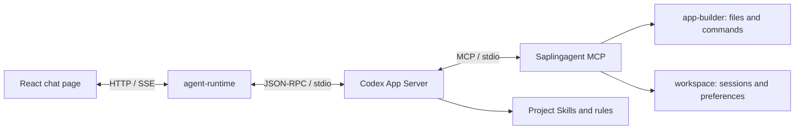

# Saplingagent

<p align="center">
  
</p>

**Let your apps grow like trees.**

Saplingagent is a minimal software seed package that you can modify yourself, directly or through conversation with AI. Start with a chat page in your own project folder, then add the interfaces, features and services you need.

Saplingagent combines a React interface with the official **Codex App Server** and optional OpenCode and Claude Agent engines, project MCP tools and reusable Skills. Application code, conversations, preferences, rules and runtime stay in the application folder. The current page includes streaming chat, Markdown with GFM tables, and Git version controls; further features are added through conversation.

**macOS 13.5+ · Windows 10/11 x64 and ARM64 · Source available for noncommercial use**

Commercial use requires separate written permission. See [LICENSE](LICENSE), [NOTICE](NOTICE) and the authentication limits below. Saplingagent is independent software and is not an official OpenAI product.

## Folder ownership and conversation receipts

The delivered application folder contains all Saplingagent-owned code, rules, Skills, configuration, documentation and launcher helpers. Dependencies install into that folder; declared model services remain external. Developing this product does not require editing another repository, global installation or external source code. Keep the complete folder together.

Customer Full Access stays enabled. Rules recommend keeping normal application changes within the folder, while an explicit request can target external code accessible to the current OS user. This recommendation does not add a path blocker or sandbox. Every final assistant reply, including read-only conversation, is instructed to include the same eight-field completion-review receipt with actual changes, checks and pending items. Read-only replies do not create task records. Model compliance requires real conversation validation.

## Install, configure, start

Get the complete application folder:

```bash
git clone --branch release https://github.com/extendmachine/Saplingagent.git
cd Saplingagent
```

Or download and extract a ZIP from the chosen branch. A private repository requires access.

Open Terminal in the application folder and run:

Use the same **Saplingagent.sh** entry on both platforms:

- **macOS:** open Terminal in the complete project folder.
- **Windows10/11 x64 or ARM64:** install/use [Git for Windows](https://gitforwindows.org/), then open **Git Bash** in the complete project folder. Windows CMD/PowerShell do not run Bash scripts directly. Git Bash is required; WSL/Linux is not this native Windows installation path.

```bash
bash Saplingagent.sh
```

First choose **English** or **中文** (Enter defaults to English), then use the same menu for every step. For Chinese directly, run `bash Saplingagent.sh --lang zh`. See the [中文安装说明](docs/macos-install.zh.html). Run the `.sh` entry in macOS Terminal or Windows Git Bash; double-click is not the supported launch method.

| Menu choice | Action |
| --- | --- |
| 1. Install / update | Prepare project-local Node, Codex, OpenCode and locked dependencies. |
| 2. Configure AI | Open the standalone local account/API configuration page. |
| 3. Start app | Launch the local services and open the chat page. |
| 4. Diagnostics | Check installation, saved AI access and runtime readiness. |
| 9. Change language | Switch English / Chinese. |
| 0. Quit | Close the menu. |

Install first, configure your own AI access, then start. Menu actions return to the menu when finished; an error leaves the menu available for retry. Stop an existing application before updating dependencies. During startup keep the terminal open; Control+C stops the owned services and exits the launcher.

Installation supports macOS 13.5+ on Apple Silicon or Intel, downloads official Node **24.21.0**, checks its official SHA-256 checksum, and installs project-local Codex **0.146.1**, OpenCode and locked dependencies. No preinstalled Node, npm, Homebrew, Xcode or Codex desktop app is required; Windows requires Git Bash and its bundled shell utilities. Windows10 must be version1809+; ARM64 and x64 are detected automatically. Internet access to official downloads, npm and your model provider is required. Versions are declared in [config/macos.json](config/macos.json) and dependency lockfiles.

Runtimes stay in `.runtime/`, dependencies in their modules' `node_modules/`, and npm cache in `.cache/npm/`. No sudo or global npm installation is needed. Keep the entire application folder; the single user-facing launcher uses its internal scripts and configuration.

**Configure AI** opens a separate local web page after installation, before the chat services are started. The page has English/Chinese controls:

- **ChatGPT account:** open the official Codex sign-in page, or use a device code. On completion the account becomes the default scheme. Existing project-local ChatGPT credentials can be selected without signing in again.
- **API / custom provider:** name a scheme, select Codex or OpenCode, choose the API protocol, enter the provider's **API Base URL**, API key and exact model ID, then **Save & use**. Use the API URL rather than a website homepage. Codex custom endpoints require Responses; OpenCode supports Chat Completions, Responses and Anthropic Messages. Presets help fill OpenAI, OpenRouter, Anthropic and local Ollama-compatible endpoints. Providers requiring other protocols, arbitrary headers or separate subscription OAuth need their own adapter.
- **Fetch models** is optional and performs a catalog GET only. If discovery is unavailable, enter the model ID manually. Use a model with streaming/tool-calling support for application development; saving a scheme does not validate compatibility or quota.
- Keep multiple schemes and select **Use** to change the default. **Finish setup** closes only this configuration service and returns to the script menu; then choose **Start app**. Closing the browser tab alone does not stop the service; Control+C stops the launcher if needed. If browser opening fails, use the loopback URL printed in the terminal.

Scheme metadata stays in `local-secrets/ai-config/connections.json`, API keys in `local-secrets/api-keys/`, and Codex sign-in credentials in `local-secrets/codex/`. The credential ledger stores file references. The page never reads saved keys back into fields; leave a key blank when editing to retain it. No global credentials are imported. OpenCode's legacy native provider selector remains available as an explicit recovery command and stores its credentials in `local-secrets/opencode/`.

Startup uses the saved default scheme. **An OpenCode-only or custom Codex API scheme does not require ChatGPT login.** Reconfigure while an app is running, then restart and start a new conversation to apply the choice. Existing conversations retain their engine/model; do not resume a Codex thread through a different provider. See [AI configuration guide](docs/ai-configuration.html) and [configuration service contract](backend/ai-config/CONTRACT.md).

Startup opens **[http://127.0.0.1:5173/](http://127.0.0.1:5173/)** after local readiness checks. Send a message to verify an actual response. Installation and saved login do not prove model access or available quota.

For automation or recovery, the same launcher accepts explicit actions:

```bash
bash Saplingagent.sh install --repair
bash Saplingagent.sh configure
bash Saplingagent.sh configure --no-open
bash Saplingagent.sh login --device-auth
bash Saplingagent.sh opencode
bash Saplingagent.sh start --no-open
bash Saplingagent.sh doctor
bash Saplingagent.sh logout
```

Device login depends on account/organization eligibility. Use `bash Saplingagent.sh` from Terminal; no executable-bit change is required for this command. `./Saplingagent.sh` also works when the executable bit is retained. Use Bash rather than `sh`: the script uses Bash syntax.

## Switch versions and restart

Use the top-right Versions control to select `main`, `testcode`, `release` or a historical commit. Pending source changes are saved locally first. Version names remain editable and do not rewrite commit hashes.

After switching, click **Restart app** to load that version's frontend, backend, Codex App Server and MCP. The options menu also offers **Restart backend** (keeps the current frontend process) and **Runtime recovery**. Wait for running AI/file work to finish or stop it yourself; restart refuses busy work.

The stable recovery page is [http://127.0.0.1:5173/__saplingagent/runtime](http://127.0.0.1:5173/__saplingagent/runtime), or your configured `frontPort`. It survives frontend/backend failure and works when an older version lacks the restart button. Repair the source/dependencies/login and retry there. Current UI recovers an unsent draft; older UIs may not. Conversations and login files remain in the application folder. No automatic resend or code rollback.

On first upgrade to this launcher, stop the existing launch window with Control+C and run `bash Saplingagent.sh start` again. The public gateway keeps port5173; Vite moves to internal port5174. Manager4314 controls Agent4310, workspace4311, builder4312 and optional PDF4313 when its source exists. If a branch adds dependencies, install them first. Manager/launcher source or port changes require a full launcher restart. Legacy direct service callers cannot be tracked by the gateway; finish their work before restarting old versions.

## Authentication and costs

**The local App Server does not charge a separate server fee. Model usage requires your own authentication and available quota.** Saplingagent includes no developer account, shared API key or promise of free model access.

| Route | Authentication and billing |
| --- | --- |
| ChatGPT account scheme | Your own ChatGPT login through official Codex; access and limits depend on the account's plan, organization and model eligibility |
| API scheme (Codex / OpenCode) | Your own provider credential and API endpoint; usage follows the provider's billing and eligibility, separate from a ChatGPT subscription. Supported protocols are selected in the setup page |

Installation, saved authentication and `model/list` discovery are separate from successful inference. Start/Doctor do not send a model prompt automatically. Sending a chat message initiates model usage. Reinstallation does not increase quota.

For current eligibility and costs, consult [Codex authentication](https://learn.chatgpt.com/docs/auth) and [Codex pricing and usage limits](https://learn.chatgpt.com/docs/pricing); no plan price or free-tier entitlement is hard-coded here.**Commercial and hosted authentication:**the current implementation uses local Codex login. OpenAI documents continuation for existing local or open-source applications and recommends migration to Sign in with ChatGPT. App Server authentication has never been permitted for commercial or hosted services. This project has not completed commercial Sign in with ChatGPT registration/integration. A separate Saplingagent commercial license does not grant OpenAI authentication rights. Before commercial distribution, resolve both permissions. See [App Server authentication](https://learn.chatgpt.com/docs/app-server) and [Sign in with ChatGPT integration](https://developers.openai.com/siwc/token-sharing-open-source/codex-app-server).

## Optional OpenCode providers

Codex is the initial default when no scheme is saved. Use **Configure AI → API / custom provider** for OpenCode with an Anthropic, OpenRouter or custom compatible endpoint; that saved scheme can be the startup default. For providers requiring the native selector instead, run `bash Saplingagent.sh opencode` as a terminal fallback. Its credentials stay under `local-secrets/opencode/`. Restart Saplingagent and choose a connected OpenCode provider/model before the first message of a new conversation. Each conversation stays bound to its original engine/model across refresh and restart; start a new conversation to switch. There is no automatic fallback between providers.

Claude can also run through the official **Claude Agent SDK** as its own local agent engine. It embeds the Claude Code agent loop with native shell/file tools, MCP, project Skills, streaming and resumable sessions. This is an embedded SDK integration, with no separate public App Server port.

Run `bash Saplingagent.sh`, choose **Install / update**, then **Configure AI** → **API / custom provider** → **Anthropic · Messages**. The preset selects **Claude Agent**. Enter your own API key, exact model ID and API Base URL (`https://api.anthropic.com/v1`, or your compatible gateway URL). **Save & use** → **Finish setup** → **Start app**. If already running, restart and create a new conversation. Model discovery is optional; gateways must support Anthropic Messages streaming and tool calls. Claude schemes do not require Codex login.

The SDK is pinned to `0.3.296` and installs its native binary inside the application folder; a separate global Claude Code installation is unnecessary. API keys stay in `local-secrets/api-keys/`, and SDK state/transcripts in `local-secrets/claude/`. Project `CLAUDE.md` imports `AGENTS.md`; `.agents/` loads the existing Skills as the `saplingagent` local plugin. Full Access remains enabled as the current OS user. There is no default whole-turn deadline, automatic fallback, automatic resend or silent replacement of missing sessions.

Claude API usage uses the customer's own account and provider billing. This application does not import or offer claude.ai subscription login: Anthropic's SDK documentation requires prior approval for third-party products offering that authentication. SDK components follow Anthropic's terms, separately from this project's license. See [SDK overview](https://code.claude.com/docs/en/agent-sdk/overview) and [quickstart / authentication](https://code.claude.com/docs/en/agent-sdk/quickstart).

Local startup proves native initialization, project MCP and Skills availability; a saved key is not a quota or inference check. Native question dialogs/MCP elicitation forms are not rendered for Claude; the agent is instructed to ask questions in ordinary chat. Windows native install, paid-provider calls and third-party gateway compatibility still require recipient testing. OpenCode's Anthropic provider remains available independently; Claude Desktop is not used as an inference backend.

## How Codex App Server connects

The installer and launcher perform the integration. Users do not need to add an MCP server to the Codex desktop app or operate a remote server.



1. [scripts/macos/codex.sh](scripts/macos/codex.sh) selects project-local Node and Codex, sets project `CODEX_HOME`, and uses file credential storage.
2. [backend/agent-runtime/rpc.mjs](backend/agent-runtime/rpc.mjs) launches `codex app-server --listen stdio://` and exchanges newline-delimited JSON through stdin/stdout.
3. [server.mjs](backend/agent-runtime/server.mjs) sends `initialize`, then `initialized`; checks `account/read` and `model/list`; creates/resumes threads; starts turns; and forwards incremental text/tool events to the browser through SSE.
4. Startup arguments configure `mcp_servers.seedagent` to launch [the project MCP server](backend/mcp-runtime/server.mjs) with local service endpoints. It exposes**15 tools** for project context, files, commands, change records, preferences and Skills.
5. Codex discovers `seed-page-edit`, `seed-research` and `seed-skill-author` under [.agents/skills/](.agents/skills/). The AI enters project rules through `AGENTS.md → rules/README.md`.

The integration does not replace global Codex configuration. Existing `seedagent`, `SEED_*`, `SEEDAGENT_*` and `seed-*` identifiers remain for protocol/data compatibility.

For protocol debugging after installation:

```bash
bash scripts/macos/codex.sh --version
bash scripts/macos/codex.sh login status
bash scripts/macos/codex.sh app-server --listen stdio://
```

The last command waits for JSON-RPC input. Send the first line, wait for its successful response, then send the remaining lines:

```jsonl
{"id":1,"method":"initialize","params":{"clientInfo":{"name":"seedagent","title":"Saplingagent","version":"0.1.0"},"capabilities":{"experimentalApi":true}}}
{"method":"initialized","params":{}}
{"id":2,"method":"account/read","params":{"refreshToken":false}}
```

This debugging process does not include the project MCP startup arguments assembled by agent-runtime. Use the normal launcher for the complete application. Protocol reference: [official App Server documentation](https://learn.chatgpt.com/docs/app-server).

## Models, permissions and configuration

Public settings live in [config/runtime.json](config/runtime.json).

| Setting | Default | Behavior |
| --- | --- | --- |
| Preferred model | `gpt-6.1-sol` | Uses the actual App Server catalog; falls back to its default/first model if unavailable |
| Reasoning effort | `medium` | Must be supported by the selected model |
| Gateway / Vite / Manager / Agent / Workspace / Builder ports | `5173` / `5174` / `4314` / `4310` / `4311` / `4312` | Local loopback services; PDF `4313` only when source exists; Agent-owned OpenCode uses `4315` |
| Permission mode | `full-access` | Codex `danger-full-access`, `approvalPolicy: never`; Claude `bypassPermissions` with sandbox disabled |
| Total turn deadline | `turnTimeoutMs: 0` | Disabled by default; explicit nonzero configuration enables a total deadline |
| Inactivity reminder | `turnIdleWarningMs: 600000` | Warns after 10 minutes without effective progress; does not stop or resend the turn |

The UI/status shows the **actual selected model**. A catalog entry is not proof of account entitlement. Tool commands have a separate timeout, normally 60 seconds and explicitly configurable up to one hour.

Full Access allows native/MCP file and shell operations wherever the current OS user has permission, including frontend, backend, MCP, Skills and rules. It does not elevate to root or bypass OS permissions. There is no Saplingagent directory allowlist, compulsory build/hash gate or automatic rollback. Recorded originals may support user-requested restoration; arbitrary commands and native writes are not guaranteed reversible.

Frontend edits use Vite hot reload. Restart after backend, MCP, Skill-discovery or dependency changes so the running processes load the new code.

## Troubleshooting

Choose Diagnostics in the menu, or run:

```bash
bash Saplingagent.sh doctor
```

Doctor reports installation, versions, saved AI configuration and configured-port status without displaying credentials or issuing model prompts.

| Symptom | Action |
| --- | --- |
| Finder opens the script in an editor | Open Terminal and run `bash Saplingagent.sh` from the project folder |
| Missing login | Run `bash Saplingagent.sh login` and finish your own login |
| Expired login or account change | Run `bash Saplingagent.sh logout`, then log in again |
| Download/dependency failure | Check Node.js/npm network access; run `bash Saplingagent.sh install --repair` |
| Installation lock remains | Confirm this project's installer has exited; remove only its stale `.runtime/node-install.lock` or `.runtime/macos-install.lock`, then retry |
| Windows operation exits 150 before device detection | Update the complete source folder; menu actions now retain foreground terminal ownership and install bypasses winpty. Retry `bash Saplingagent.sh --lang zh install` in Git Bash and retain preceding error text if it still fails; the exit number alone is not a diagnosis |
| Port occupied | Stop your previous startup terminal or adjust `config/runtime.json`; the launcher does not kill another project's process |
| Not ready within 120 seconds | Run Doctor and inspect the startup terminal and metadata in `logs/<service>/` |
| Local service connection failed | Keep the startup terminal running and restart the full application; check Agent port `4310` and the frontend proxy |
| Session does not exist | The UI retains unsent/retry input and starts a new session; do not delete `data/` to resolve it |
| No recent progress | Check whether a tool or user decision is pending; continue waiting or stop manually. The reminder does not impose a default turn deadline |
| Quota/model authorization error | Check the actual account error and official usage limits; reinstalling cannot grant model access |

Stop services before moving the application. Move the whole folder. On the same architecture, launchers resolve the new location; reinstall after changing architecture or lockfiles.

## Application structure

```text
Saplingagent/
├── Saplingagent.sh          # macOS English / Chinese menu
├── front/                     # React chat and application features
├── backend/
│   ├── agent-runtime/         # App Server client, turns, SSE, Git API
│   ├── workspace/             # Local sessions, preferences and evidence
│   ├── app-builder/           # File/command tools and optional restoration
│   └── mcp-runtime/           # MCP stdio tools
├── .agents/skills/            # Project workflows
├── contracts/                 # Public service contracts
├── config/ / scripts/         # Configuration, install, run and packaging
├── rules/ / docs/             # AI rules and human HTML guides
├── LICENSE / NOTICE / THIRD_PARTY_NOTICES.md
├── local-secrets/             # Private credentials; ignored by Git
├── .runtime/                  # Local Node/Codex; ignored by Git
├── data/ / snapshots/ / logs/  # Private local runtime content; ignored by Git
└── AGENTS.md / FINAL_GOAL.md / TODO.md / AI_TASKS.md
```

Git controls can save tracked/nonignored changes into a local commit and switch local branches, automatically committing pending changes first. These actions do not publish to GitHub. A ZIP without `.git/` can run chat but has no Git repository; initialize Git explicitly if version controls are desired.

AI development starts with [AGENTS.md](AGENTS.md) and [rules/README.md](rules/README.md). Services maintain `SERVICE.md`, `CONTRACT.md`, `DEPLOY.md` and `REFERENCES.md`. Technical paths and protocol identifiers retain compatibility; existing user conversations are never translated by this release.

## Branches and release preparation

Only three named branches are maintained:

| Branch | Role |
| --- | --- |
| `main` | Shared development baseline and code review |
| `testcode` | Local/user experimentation based on the same reviewed baseline |
| `release` | Customer-facing source distribution |

This English candidate is intended for all three branches after exact-version human approval. Previous branch histories remain reachable. New changes are not silently propagated or presented as an approved release.

To prepare a clean source ZIP from a committed revision, use the installed project Node:

```bash
SEED_NODE_VERSION="$(/usr/bin/plutil -extract nodeVersion raw -o - config/macos.json)"
SEED_ARCH="$(/usr/bin/uname -m)"
if [ "$SEED_ARCH" = "x86_64" ]; then SEED_ARCH=x64; fi
".runtime/node-v${SEED_NODE_VERSION}-darwin-${SEED_ARCH}/bin/node" scripts/package-macos.mjs HEAD
```

The package and `.sha256` file are written to `.cache/releases/`. It contains committed source, complete rules/Skills, license notices, pinned lockfiles and a per-file SHA-256 manifest in `delivery.json`. Recipient task/goal files are initialized without inheriting developer approvals. It excludes credentials, conversations, logs, snapshots, dependency directories and installed runtimes.

**Do not distribute a ZIP of your running project folder.**Use this packager. GitHub Download ZIP is a source snapshot; the customer packager additionally initializes recipient task records. Repackaging requires Git; installing an extracted package does not.

Release checklist and known validation limits: [docs/release-checklist.html](docs/release-checklist.html). Public repository visibility and a published GitHub release are separate actions from preparing this candidate.

## License

Project-owned source is available under**[PolyForm Noncommercial 1.0.0](LICENSE)**. It permits uses, modifications and distribution for its permitted noncommercial purposes, subject to its notice requirements. Commercial use needs a separate written agreement with the project owner; request authorization through [extendmachine](https://github.com/extendmachine). This is a source-available license, not an unrestricted open-source commercial grant.

The license includes defined permissions for certain noncommercial organizations. The exact [official terms](https://polyformproject.org/licenses/noncommercial/1.0.0) govern scope. Dependencies and bundled third-party materials retain their own terms in [THIRD_PARTY_NOTICES.md](THIRD_PARTY_NOTICES.md); this project's restriction does not relicense them or claim ownership of user-generated applications.

## References and development rules

Installation and integration documentation checked on **2026-10-10**:

- [Codex App Server](https://learn.chatgpt.com/docs/app-server)
- [Codex authentication](https://learn.chatgpt.com/docs/auth)
- [Codex usage and pricing](https://learn.chatgpt.com/docs/pricing)
- [Sign in with ChatGPT / App Server](https://developers.openai.com/siwc/token-sharing-open-source/codex-app-server)
- [Local documentation](docs/index.html), [macOS guide](docs/macos-install.html), [service interfaces](docs/api-interfaces.html)

The user's project rules ship under `rules/`. Translating their prose does not relax approval, credential handling or task-coordination requirements. The complete [rules distribution guide](rules/DISTRIBUTION.md) applies only when explicitly asked to introduce/copy the rules into another project; normal installation requires no developer-specific rules source folder.

## Windows operation and delivery

Run `bash Saplingagent.sh --lang zh` in Git Bash. The single English/Chinese menu provides Install / update, Configure AI (independent account/API web page), Start app and Diagnostics. Explicit actions/flags are identical to Mac: `install --repair`, `configure --no-open`, `login --device-auth`, `opencode`, `start --no-open`, `doctor`, `logout`. See [Windows guide](docs/windows-install.html) / [中文 Windows 说明](docs/windows-install.zh.html).

Windows system detection/download/extraction uses its built-in PowerShell internally, embedded in scripts/windows/bootstrap.sh; there is no separate .ps1 file or user PowerShell command. UTF16 encoded command arguments preserve Unicode paths and leave stdin available for provider authentication. Windows menu actions run in the foreground. Installation/diagnostics use PowerShell directly; Git Bash's winpty is used when available for native login/OpenCode/start console compatibility. Windows terminal shutdown/model interactions still require native-system testing. No WSL, global Node/Codex, registry/global PATH/permanent execution-policy modification is required.

The App Server is a project-owned native stdio subprocess. Credentials remain in local-secrets/codex/ and local-secrets/opencode/; dependencies/cache/state stay in the folder. The UI remains English; menu language does not change conversation data. Full Access remains current-user access. Git is required to supply Bash on Windows; branch/version controls additionally require an actual Git repository, which source ZIPs do not contain.

Restart app/Restart backend use the existing persistent gateway and owned live PID-tree shutdown. Finish work before restarting. Forced parent/window termination, power loss and separately detached programs cannot guarantee cleanup; active command side effects are not undone. Ports/manager/launcher changes require normal stop and reopening the same Bash entry. No process-name/port kill, root elevation, automatic rollback or prompt resend is added.

To create a committed clean Windows source ZIP, use `<project-node> scripts/package-windows.mjs HEAD .cache/releases`. Both platform packages include the one executable Saplingagent.sh, all companion sources/helpers/rules, fresh recipient records and per-file/ZIP hashes, excluding credentials/data/logs/dependencies/Git. Copy the complete folder, not just one script. Remove stale installation locks only after confirming the installer has stopped.

## Automatic device selection

The common Bash entry detects macOS or native Windows Bash environments and routes automatically. Mac chooses Intelx64 or AppleSiliconarm64 (including Rosetta). Windows verifies build17763+, selects native x64/ARM64 ahead of emulated-terminal architecture, checks official Node24.21.0 checksums and actual runtime architecture, then installs pinned Codex0.146.1/OpenCode1.19.0 native binaries. No manual CPU selection. Linux/WSL and32-bit devices fail before download. Re-run Install / update after moving the source folder to another device; installed dependencies are OS-specific. Native Windows login/model/MCP/restart and ARM hardware tests remain unverified on the current Mac host.
