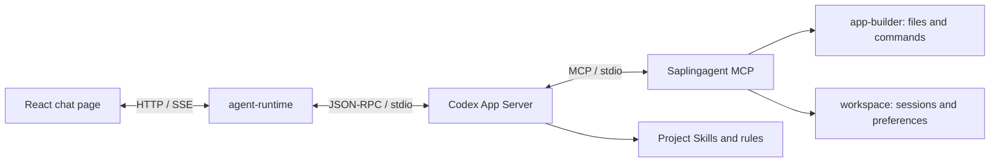

# Saplingagent

<p align="center">
  
</p>

**Let your apps grow like trees.**

Saplingagent is a minimal software seed package that you can modify yourself, directly or through conversation with AI. Start with a chat page in your own project folder, then add the interfaces, features and services you need.

Saplingagent combines a React interface with the official**Codex App Server**, project MCP tools and reusable Skills. Application code, conversations, preferences, rules and runtime stay in the application folder. The current page includes streaming chat, Markdown with GFM tables, and Git version controls; further features are added through conversation.

**macOS 13.5+ · Apple Silicon and Intel installers · Source available for noncommercial use**Commercial use requires separate written permission. See [LICENSE](LICENSE), [NOTICE](NOTICE) and the authentication limits below. Saplingagent is independent software and is not an official OpenAI product.

## Install, configure, start

Get the complete application folder:

```bash
git clone --branch release https://github.com/extendmachine/Saplingagent.git
cd Saplingagent
```

Or download and extract a ZIP from the chosen branch. A private repository requires access.

**Double-click `Saplingagent.command`**, or run:

```bash
bash Saplingagent.command
```

Use the same menu for every step:

| Menu choice | Action |
| --- | --- |
| 1. Install / update | Prepare project-local Node, Codex, OpenCode and locked dependencies. |
| 2. Configure AI | Choose Codex account login or OpenCode provider/API-key setup. |
| 3. Start app | Launch the local services and open the chat page. |
| 4. Diagnostics | Check installation, saved login and runtime readiness. |
| 0. Quit | Close the menu. |

Install first, configure your own AI access, then start. Menu actions return to the menu when finished; an error leaves the menu available for retry. Stop an existing application before updating dependencies. During startup keep the terminal open; Control+C stops the owned services and exits the launcher.

Installation supports macOS 13.5+ on Apple Silicon or Intel, downloads official Node **24.21.0**, checks its official SHA-256 checksum, and installs project-local Codex **0.146.1**, OpenCode and locked dependencies. No preinstalled Node, npm, Homebrew, Xcode or Codex desktop app is required. Internet access to official downloads, npm and your model provider is required. Versions are declared in [config/macos.json](config/macos.json) and dependency lockfiles.

Runtimes stay in `.runtime/`, dependencies in their modules' `node_modules/`, and npm cache in `.cache/npm/`. No sudo or global npm installation is needed. Keep the entire application folder; the single user-facing launcher uses its internal scripts and configuration.

**Configure AI → Codex** opens the official login flow for your own account and stores project credentials under `local-secrets/codex/`. It does not import global credentials. **Configure AI → OpenCode** opens the provider credential selector and uses project-isolated `local-secrets/opencode/`. This launcher still checks Codex login at startup; OpenCode is an additional engine chosen for new conversations. Custom API endpoints also need provider/model configuration; see the OpenCode section below.

Startup opens **[http://127.0.0.1:5173/](http://127.0.0.1:5173/)** after local readiness checks. Send a message to verify an actual response. Installation and saved login do not prove model access or available quota.

For automation or recovery, the same launcher accepts explicit actions:

```bash
bash Saplingagent.command install --repair
bash Saplingagent.command login --device-auth
bash Saplingagent.command opencode
bash Saplingagent.command start --no-open
bash Saplingagent.command doctor
bash Saplingagent.command logout
```

Device login depends on account/organization eligibility. If Finder does not execute a downloaded launcher, use the bash command and normal macOS first-open prompts.

## Switch versions and restart

Use the top-right Versions control to select `main`, `testcode`, `release` or a historical commit. Pending source changes are saved locally first. Version names remain editable and do not rewrite commit hashes.

After switching, click **Restart app** to load that version's frontend, backend, Codex App Server and MCP. The options menu also offers **Restart backend** (keeps the current frontend process) and **Runtime recovery**. Wait for running AI/file work to finish or stop it yourself; restart refuses busy work.

The stable recovery page is [http://127.0.0.1:5173/__saplingagent/runtime](http://127.0.0.1:5173/__saplingagent/runtime), or your configured `frontPort`. It survives frontend/backend failure and works when an older version lacks the restart button. Repair the source/dependencies/login and retry there. Current UI recovers an unsent draft; older UIs may not. Conversations and login files remain in the application folder. No automatic resend or code rollback.

On first upgrade to this launcher, stop the existing launch window with Control+C and run `Saplingagent.command start` again. The public gateway keeps port5173; Vite moves to internal port5174. Manager4314 controls Agent4310, workspace4311, builder4312 and optional PDF4313 when its source exists. If a branch adds dependencies, install them first. Manager/launcher source or port changes require a full launcher restart. Legacy direct service callers cannot be tracked by the gateway; finish their work before restarting old versions.

## Authentication and costs**The local App Server does not charge a separate server fee. Model usage requires your own authentication and available quota.**Saplingagent includes no developer account, shared API key or promise of free model access.

| Route | Authentication and billing |
| --- | --- |
| Default Mac login | Your own ChatGPT login through official Codex; access and limits depend on the account's plan, organization and model eligibility |
| Codex API-key route | Your own OpenAI API key; API usage is billed separately from ChatGPT subscription usage. The Mac launchers currently guide users through ChatGPT login and do not provide a dedicated API-key setup flow |

Installation, saved authentication and `model/list` discovery are separate from successful inference. Start/Doctor do not send a model prompt automatically. Sending a chat message initiates model usage. Reinstallation does not increase quota.

For current eligibility and costs, consult [Codex authentication](https://learn.chatgpt.com/docs/auth) and [Codex pricing and usage limits](https://learn.chatgpt.com/docs/pricing); no plan price or free-tier entitlement is hard-coded here.**Commercial and hosted authentication:**the current implementation uses local Codex login. OpenAI documents continuation for existing local or open-source applications and recommends migration to Sign in with ChatGPT. App Server authentication has never been permitted for commercial or hosted services. This project has not completed commercial Sign in with ChatGPT registration/integration. A separate Saplingagent commercial license does not grant OpenAI authentication rights. Before commercial distribution, resolve both permissions. See [App Server authentication](https://learn.chatgpt.com/docs/app-server) and [Sign in with ChatGPT integration](https://developers.openai.com/siwc/token-sharing-open-source/codex-app-server).

## Optional OpenCode providers

Codex remains the default. To use Anthropic, OpenRouter, a custom OpenAI-compatible endpoint, or another provider supported by OpenCode, first install the current lockfiles and run:

```bash
bash Saplingagent.command opencode
```

Provider credentials are stored only under `local-secrets/opencode/`. Restart Saplingagent, choose **OpenCode** before the first message of a new conversation, then choose a connected provider and model. Each conversation stays bound to its original engine/model across refresh and restart; start a new conversation to switch. There is no automatic fallback between providers.

Claude uses an Anthropic API credential through OpenCode. A Claude Desktop subscription or login is not imported and Claude Desktop is not automated as an inference backend. Desktop extensions let Claude call MCP servers; that is a different integration direction. See the official [OpenCode provider guide](https://opencode.ai/docs/providers/) and [Anthropic client SDK guidance](https://platform.claude.com/docs/en/api/client-sdks).

## How Codex App Server connects

The installer and launcher perform the integration. Users do not need to add an MCP server to the Codex desktop app or operate a remote server.



1. [scripts/macos/codex.sh](scripts/macos/codex.sh) selects project-local Node and Codex, sets project `CODEX_HOME`, and uses file credential storage.
2. [backend/agent-runtime/rpc.mjs](backend/agent-runtime/rpc.mjs) launches `codex app-server --listen stdio://` and exchanges newline-delimited JSON through stdin/stdout.
3. [server.mjs](backend/agent-runtime/server.mjs) sends `initialize`, then `initialized`; checks `account/read` and `model/list`; creates/resumes threads; starts turns; and forwards incremental text/tool events to the browser through SSE.
4. Startup arguments configure `mcp_servers.seedagent` to launch [the project MCP server](backend/mcp-runtime/server.mjs) with local service endpoints. It exposes**15 tools** for project context, files, commands, change records, preferences and Skills.
5. Codex discovers `seed-page-edit`, `seed-research` and `seed-skill-author` under [.agents/skills/](.agents/skills/). The AI enters project rules through `AGENTS.md → rules/README.md`.

The integration does not replace global Codex configuration. Existing `seedagent`, `SEED_*`, `SEEDAGENT_*` and `seed-*` identifiers remain for protocol/data compatibility.

For protocol debugging after installation:

```bash
bash scripts/macos/codex.sh --version
bash scripts/macos/codex.sh login status
bash scripts/macos/codex.sh app-server --listen stdio://
```

The last command waits for JSON-RPC input. Send the first line, wait for its successful response, then send the remaining lines:

```jsonl
{"id":1,"method":"initialize","params":{"clientInfo":{"name":"seedagent","title":"Saplingagent","version":"0.1.0"},"capabilities":{"experimentalApi":true}}}
{"method":"initialized","params":{}}
{"id":2,"method":"account/read","params":{"refreshToken":false}}
```

This debugging process does not include the project MCP startup arguments assembled by agent-runtime. Use the normal launcher for the complete application. Protocol reference: [official App Server documentation](https://learn.chatgpt.com/docs/app-server).

## Models, permissions and configuration

Public settings live in [config/runtime.json](config/runtime.json).

| Setting | Default | Behavior |
| --- | --- | --- |
| Preferred model | `gpt-6.1-sol` | Uses the actual App Server catalog; falls back to its default/first model if unavailable |
| Reasoning effort | `medium` | Must be supported by the selected model |
| Gateway / Vite / Manager / Agent / Workspace / Builder ports | `5173` / `5174` / `4314` / `4310` / `4311` / `4312` | Local loopback services; PDF `4313` only when source exists; Agent-owned OpenCode uses `4315` |
| Permission mode | `full-access` | Codex `danger-full-access`, `approvalPolicy: never` |
| Total turn deadline | `turnTimeoutMs: 0` | Disabled by default; explicit nonzero configuration enables a total deadline |
| Inactivity reminder | `turnIdleWarningMs: 600000` | Warns after 10 minutes without effective progress; does not stop or resend the turn |

The UI/status shows the **actual selected model**. A catalog entry is not proof of account entitlement. Tool commands have a separate timeout, normally 60 seconds and explicitly configurable up to one hour.

Full Access allows native/MCP file and shell operations wherever the current macOS user has permission, including frontend, backend, MCP, Skills and rules. It does not elevate to root or bypass macOS permissions. There is no Saplingagent directory allowlist, compulsory build/hash gate or automatic rollback. Recorded originals may support user-requested restoration; arbitrary commands and native writes are not guaranteed reversible.

Frontend edits use Vite hot reload. Restart after backend, MCP, Skill-discovery or dependency changes so the running processes load the new code.

## Troubleshooting

Double-click **`Saplingagent.command doctor`**, or run:

```bash
bash Saplingagent.command doctor
```

Doctor reports installation, versions, saved login and configured-port status without displaying credentials or issuing model prompts.

| Symptom | Action |
| --- | --- |
| Launcher does not open | Run its `bash` command from the project folder; follow normal macOS first-open prompts |
| Missing login | Run `Saplingagent.command login` and finish your own login |
| Expired login or account change | Run `bash Saplingagent.command logout`, then log in again |
| Download/dependency failure | Check Node.js/npm network access; run `bash Saplingagent.command install --repair` |
| Installation lock remains | Confirm this project's installer has exited; remove only its stale `.runtime/node-install.lock` or `.runtime/macos-install.lock`, then retry |
| Port occupied | Stop your previous startup terminal or adjust `config/runtime.json`; the launcher does not kill another project's process |
| Not ready within 120 seconds | Run Doctor and inspect the startup terminal and metadata in `logs/<service>/` |
| Local service connection failed | Keep the startup terminal running and restart the full application; check Agent port `4310` and the frontend proxy |
| Session does not exist | The UI retains unsent/retry input and starts a new session; do not delete `data/` to resolve it |
| No recent progress | Check whether a tool or user decision is pending; continue waiting or stop manually. The reminder does not impose a default turn deadline |
| Quota/model authorization error | Check the actual account error and official usage limits; reinstalling cannot grant model access |

Stop services before moving the application. Move the whole folder. On the same architecture, launchers resolve the new location; reinstall after changing architecture or lockfiles.

## Application structure

```text
Saplingagent/
├── Saplingagent.command install / Saplingagent.command login
├── Saplingagent.command start / Saplingagent.command doctor
├── front/                     # React chat and application features
├── backend/
│   ├── agent-runtime/         # App Server client, turns, SSE, Git API
│   ├── workspace/             # Local sessions, preferences and evidence
│   ├── app-builder/           # File/command tools and optional restoration
│   └── mcp-runtime/           # MCP stdio tools
├── .agents/skills/            # Project workflows
├── contracts/                 # Public service contracts
├── config/ / scripts/         # Configuration, install, run and packaging
├── rules/ / docs/             # AI rules and human HTML guides
├── LICENSE / NOTICE / THIRD_PARTY_NOTICES.md
├── local-secrets/             # Private credentials; ignored by Git
├── .runtime/                  # Local Node/Codex; ignored by Git
├── data/ / snapshots/ / logs/  # Private local runtime content; ignored by Git
└── AGENTS.md / FINAL_GOAL.md / TODO.md / AI_TASKS.md
```

Git controls can save tracked/nonignored changes into a local commit and switch local branches, automatically committing pending changes first. These actions do not publish to GitHub. A ZIP without `.git/` can run chat but has no Git repository; initialize Git explicitly if version controls are desired.

AI development starts with [AGENTS.md](AGENTS.md) and [rules/README.md](rules/README.md). Services maintain `SERVICE.md`, `CONTRACT.md`, `DEPLOY.md` and `REFERENCES.md`. Technical paths and protocol identifiers retain compatibility; existing user conversations are never translated by this release.

## Branches and release preparation

Only three named branches are maintained:

| Branch | Role |
| --- | --- |
| `main` | Shared development baseline and code review |
| `testcode` | Local/user experimentation based on the same reviewed baseline |
| `release` | Customer-facing source distribution |

This English candidate is intended for all three branches after exact-version human approval. Previous branch histories remain reachable. New changes are not silently propagated or presented as an approved release.

To prepare a clean source ZIP from a committed revision, use the installed project Node:

```bash
SEED_NODE_VERSION="$(/usr/bin/plutil -extract nodeVersion raw -o - config/macos.json)"
SEED_ARCH="$(/usr/bin/uname -m)"
if [ "$SEED_ARCH" = "x86_64" ]; then SEED_ARCH=x64; fi
".runtime/node-v${SEED_NODE_VERSION}-darwin-${SEED_ARCH}/bin/node" scripts/package-macos.mjs HEAD
```

The package and `.sha256` file are written to `.cache/releases/`. It contains committed source, complete rules/Skills, license notices, pinned lockfiles and a per-file SHA-256 manifest in `delivery.json`. Recipient task/goal files are initialized without inheriting developer approvals. It excludes credentials, conversations, logs, snapshots, dependency directories and installed runtimes.

**Do not distribute a ZIP of your running project folder.**Use this packager. GitHub Download ZIP is a source snapshot; the customer packager additionally initializes recipient task records. Repackaging requires Git; installing an extracted package does not.

Release checklist and known validation limits: [docs/release-checklist.html](docs/release-checklist.html). Public repository visibility and a published GitHub release are separate actions from preparing this candidate.

## License

Project-owned source is available under**[PolyForm Noncommercial 1.0.0](LICENSE)**. It permits uses, modifications and distribution for its permitted noncommercial purposes, subject to its notice requirements. Commercial use needs a separate written agreement with the project owner; request authorization through [extendmachine](https://github.com/extendmachine). This is a source-available license, not an unrestricted open-source commercial grant.

The license includes defined permissions for certain noncommercial organizations. The exact [official terms](https://polyformproject.org/licenses/noncommercial/1.0.0) govern scope. Dependencies and bundled third-party materials retain their own terms in [THIRD_PARTY_NOTICES.md](THIRD_PARTY_NOTICES.md); this project's restriction does not relicense them or claim ownership of user-generated applications.

## References and development rules

Installation and integration documentation checked on **2026-10-10**:

- [Codex App Server](https://learn.chatgpt.com/docs/app-server)
- [Codex authentication](https://learn.chatgpt.com/docs/auth)
- [Codex usage and pricing](https://learn.chatgpt.com/docs/pricing)
- [Sign in with ChatGPT / App Server](https://developers.openai.com/siwc/token-sharing-open-source/codex-app-server)
- [Local documentation](docs/index.html), [macOS guide](docs/macos-install.html), [service interfaces](docs/api-interfaces.html)

The user's project rules ship under `rules/`. Translating their prose does not relax approval, credential handling or task-coordination requirements. The complete [rules distribution guide](rules/DISTRIBUTION.md) applies only when explicitly asked to introduce/copy the rules into another project; normal installation requires no developer-specific rules source folder.
