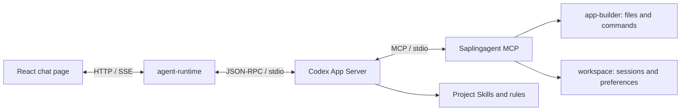

<h1 align="center">Saplingagent</h1>

<p align="center">
  
</p>

<h3 align="center">From a conversation to your own application.</h3>

<p align="center">
  A local workspace for building and evolving software with AI.<br>
  Start with one chat. Shape the interface, add capabilities, and keep the code in your own project.
</p>

<p align="center">
  <strong>English</strong> · <a href="README.zh-CN.md">简体中文</a>
</p>

<p align="center">
  <a href="#demo"><strong>▶ English demo · 1:41</strong></a> &nbsp;·&nbsp;
  <a href="#install-configure-start">Get started</a> &nbsp;·&nbsp;
  <a href="docs/index.html">Documentation</a>
</p>

<p align="center"><sub>macOS 13.5+ · Windows 10/11 x64 & ARM64 · Source available for noncommercial use</sub></p>

<a id="demo"></a>

https://github.com/user-attachments/assets/6f43f15f-38c4-4650-9383-669caa635dc8

<p align="center"><sub>English narration and captions · 1:41 · <a href="https://github.com/extendmachine/Saplingagent/releases/download/demo-2026-10-14/Saplingagent-English-Demo-Final.mp4">Download the high-quality original</a></sub></p>

---

- **Build through conversation.** Turn requests into React interfaces and local application features.
- **Keep your project local.** Code, conversations and version history stay with your application.
- **Extend as you grow.** Connect Codex, OpenCode or Claude Agent with MCP tools and reusable Skills.

See a request become a working clock, then a saved version. English narration and captions · 1:41.

<a id="document-workspace"></a>

## Case study · A WPS-style local document workspace

From one chat page to a document workspace. Browse files, make basic Office edits, work with PDFs and keep AI conversation alongside your documents.

This is an example application built with Saplingagent. The default installation starts with the minimal chat interface.


| Module | What the example does |
| --- | --- |
| File browsing and management | Browse a folder tree, filter file names, refresh listings, create files and folders, and copy absolute paths. |
| Word documents | Preview DOCX, edit paragraph text directly, and adjust paragraph-wide font, size, emphasis, color and alignment. |
| Spreadsheets | Open Excel, CSV and ODS files, switch worksheets, and edit cell values or formula text. |
| PowerPoint | View PPTX slides and edit their text through a structured panel. |
| PDF reading and editing | Navigate and zoom, add or replace text, fill text form fields, rotate or reorder pages, and delete pages. |
| Local OCR | Recognize English or Simplified Chinese on a page, then select the recognized text for editing. |
| PDF graphics | Replace, crop and adjust image objects; change vector geometry, color and paths. |
| Markdown and code | Switch between Markdown editing and preview, and edit common code, configuration and text files. |
| Images and media | Preview images and play audio or video files. |
| Save and restore | Check for external file changes before saving, flag unsaved work, and restore the version before the last save. |

**Word editing** — work directly on rendered paragraphs with a formatting toolbar.


**PDF and OCR** — local Simplified Chinese OCR with a recognized line selected in the text editor.


<details>
<summary>Editing scope</summary>

Office editing covers basic changes. Word controls format whole paragraphs; PowerPoint edits text rather than objects or animations. The spreadsheet view shows the first 250 rows and 60 columns; formula text can be edited, but no formula calculation engine is provided. PDF replacement can change typography or affect overlapping objects. The file panel currently covers browsing and creation; rename, move and recycle-bin workflows are not implemented.

</details>

<details>
<summary>Explore the full guide</summary>


- [Install, configure, start](#install-configure-start)
- [Choose Git storage](#choose-where-your-application-lives)
- [Switch versions and restart](#switch-versions-and-restart)
- [Update or repair an existing installation](#what-menu-1-updates)
- [Authentication and costs](#authentication-and-costs)
- [Models, permissions and configuration](#models-permissions-and-configuration)
- [Troubleshooting](#troubleshooting)
- [Application structure](#application-structure)
- [Branches and source delivery](#branches-and-release-preparation)
- [License](#license)

</details>

## Install, configure, start

### 1. Get the complete application

For a new installation, run one command in **macOS Terminal** or **Windows Git Bash** (install [Git for Windows](https://gitforwindows.org/) first):

```bash
bash -o pipefail -c 'curl -fsSL https://raw.githubusercontent.com/extendmachine/Saplingagent/release/install.sh | bash'
```

The independent `install.sh` resolves the current **release** commit, downloads that exact source snapshot into `./Saplingagent`, runs the existing installer, then opens the configuration/start menu. It does not clone all repository branches or require Node before downloading. Git storage remains your choice: local-only, your own repository, or following release. Configure your own AI access and choose Start app after installation.

The target folder must be new; existing applications are preserved. Add `--dir` and `--lang` for a different destination/language:

```bash
bash -o pipefail -c 'curl -fsSL https://raw.githubusercontent.com/extendmachine/Saplingagent/release/install.sh | bash -s -- --dir "./My Saplingagent" --lang zh'
```

Use `--download-only` to fetch source without installing or opening a menu; then run `bash Saplingagent.sh` inside the downloaded folder. First Install initializes recipient goal/task records; edits made before installation are preserved with a warning. The script needs HTTPS access to GitHub API/archive endpoints and standard curl/tar/SHA256 tools (macOS and Git Bash supply them). API/rate-limit/download failures are reported; retry in a new folder if a completed source folder already exists. All dependencies and configuration install locally. This command is for fresh installation, not automatic source updates.

Only release is downloaded. Follow mode stores a single selected-branch fetch mapping and skips tags, so normal subsequent fetches do not bring author main/adobe-replica into the local branch list. Local mode's empty main is your own independent history. An explicitly configured branch remains supported; existing local branches are preserved. The public repository remains manually accessible; this is a default delivery workflow, not a permission restriction.

Alternatively get the complete application folder manually:

```bash
git clone --single-branch --branch release --no-tags https://github.com/extendmachine/Saplingagent.git
cd Saplingagent
```

Or [download release source](https://github.com/extendmachine/Saplingagent/archive/refs/heads/release.zip) and extract it. Customer downloads use `release`; choose another branch explicitly if needed. A private repository requires access.

### 2. Install through the launcher

Use the same **Saplingagent.sh** entry from the application folder on both platforms:

- **macOS:** open Terminal in the complete project folder.
- **Windows10/11 x64 or ARM64:** install/use [Git for Windows](https://gitforwindows.org/), then open **Git Bash** in the complete project folder. Windows CMD/PowerShell do not run Bash scripts directly. Git Bash is required; WSL/Linux is not this native Windows installation path.

```bash
bash Saplingagent.sh
```

First choose **English** or **中文** (Enter defaults to English), then use the same menu for every step. For Chinese directly, run `bash Saplingagent.sh --lang zh`. See the [中文安装说明](docs/macos-install.zh.html). Run the `.sh` entry in macOS Terminal or Windows Git Bash; double-click is not the supported launch method.

| Menu choice | Action |
| --- | --- |
| 1. Install / update | Available before a storage choice and in follow mode. Check source/dependencies and reload changed upstream source. Hidden after choosing local Git or your own repository. |
| 2. Configure AI | Open the standalone local account/API configuration page. |
| 3. Start app | Launch the local services and open the chat page. |
| 4. Diagnostics | Check installation, saved AI access and runtime readiness. |
| 5. Git / storage setup | Review or change repository ownership without reinstalling dependencies. |
| 9. Change language | Switch English / Chinese. |
| 0. Quit | Close the menu. |

Choose **1. Install / update** if you downloaded the folder manually. The one-command installer already runs this step. Next choose **2. Configure AI**, finish setup, then **3. Start app**. Menu actions return to the menu when finished; an error leaves the menu available for retry. Stop an existing application before updating dependencies. While the app is running, keep the terminal open; Control+C stops the owned services and exits the launcher.

Installation supports macOS 13.5+ on Apple Silicon or Intel, downloads official Node **24.21.0**, checks its official SHA-256 checksum, and installs project-local Codex **0.146.1**, OpenCode, Claude Agent SDK **0.3.296** and locked dependencies. No preinstalled Node, npm, Homebrew or Codex desktop app is required. Git is required for local version history; on Mac, install Apple Command Line Tools with `xcode-select --install` if Git is missing (full Xcode is unnecessary); Windows requires Git Bash and its bundled shell utilities. Windows10 must be version1809+; ARM64 and x64 are detected automatically. Internet access to official downloads, npm and your model provider is required. Versions are declared in [config/macos.json](config/macos.json) and dependency lockfiles.

Runtimes stay in `.runtime/`, dependencies in their modules' `node_modules/`, and npm cache in `.cache/npm/`. No sudo or global npm installation is needed. Keep the entire application folder; the single user-facing launcher uses its internal scripts and configuration.

### 3. Configure AI and start your first conversation

**Configure AI** opens a separate local web page after installation, before the chat services are started. The page has English/Chinese controls:

- **ChatGPT account:** open the official Codex sign-in page, or use a device code. On completion the account becomes the default scheme. Existing project-local ChatGPT credentials can be selected without signing in again.
- **API / custom provider:** name a scheme, select Codex, OpenCode or Claude Agent, choose the API protocol, enter the provider's **API Base URL**, API key and exact model ID, then **Save & use**. Use the API URL rather than a website homepage. Codex custom endpoints require Responses; Claude Agent requires Anthropic Messages with an API scheme; OpenCode supports Chat Completions, Responses and Anthropic Messages. Presets help fill OpenAI, OpenRouter, Anthropic and local Ollama-compatible endpoints. Providers requiring other protocols, arbitrary headers or separate subscription OAuth need their own adapter.
- **Fetch models** is optional and performs a catalog GET only. If discovery is unavailable, enter the model ID manually. Use a model with streaming/tool-calling support for application development; saving a scheme does not validate compatibility or quota.
- Keep multiple schemes and select **Use** to change the default. **Finish setup** closes only this configuration service and returns to the script menu; then choose **Start app**. Closing the browser tab alone does not stop the service; Control+C stops the launcher if needed. If browser opening fails, use the loopback URL printed in the terminal.

Scheme metadata stays in `local-secrets/ai-config/connections.json`, API keys in `local-secrets/api-keys/`, and Codex sign-in credentials in `local-secrets/codex/`. The credential ledger stores file references. The page never reads saved keys back into fields; leave a key blank when editing to retain it. No global credentials are imported. OpenCode's legacy native provider selector remains available as an explicit recovery command and stores its credentials in `local-secrets/opencode/`.

Startup uses the saved default scheme. **An OpenCode-only or custom Codex API scheme does not require ChatGPT login.** Reconfigure while an app is running, then restart and start a new conversation to apply the choice. Existing conversations retain their engine/model; do not resume a Codex thread through a different provider. See [AI configuration guide](docs/ai-configuration.html) and [configuration service contract](backend/ai-config/CONTRACT.md).

Startup opens the **actual address printed in the terminal** after local readiness checks. Port5173 is the default starting point; occupied public/internal ports are skipped upward. Send a message to verify an actual response. Installation and saved login do not prove model access or available quota.

### Command-line actions

For automation or recovery, the same launcher accepts explicit actions:

```bash
bash Saplingagent.sh install --repair
bash Saplingagent.sh configure
bash Saplingagent.sh configure --no-open
bash Saplingagent.sh login --device-auth
bash Saplingagent.sh opencode
bash Saplingagent.sh start --no-open
bash Saplingagent.sh doctor
bash Saplingagent.sh git
bash Saplingagent.sh logout
```

Device login depends on account/organization eligibility. Use `bash Saplingagent.sh` from Terminal; no executable-bit change is required for this command. `./Saplingagent.sh` also works when the executable bit is retained. Use Bash rather than `sh`: the script uses Bash syntax.

## Choose where your application lives

On first **Install / update**, choose one storage mode:

| Choice | Local history | Remote behavior |
| --- | --- | --- |
| 1. Local only | Clear previous Git metadata; initialize empty `main` with **zero commits** | Remove all remote configuration; no cloud links |
| 2. My own repository | Local commits; fresh folder starts on `release`; existing selected version is retained | Add or update `origin` to your repository URL; nothing is pushed during installation |
| 3. Follow Saplingagent release | Track the author's `upstream/release` | Fetch upstream history; menu 1 explicitly checks/merges compatible source; no push or PR |

Choosing **1. Local only** deletes this folder's previous Git history, branches, tags, version names, staged index and remote configuration, then initializes an empty `main`. Application files (including pending source), data and credentials remain in place. There is no automatic initial commit. The page shows only `main` and **No commits yet**; use **Save version** explicitly when you want your first local record. The launcher displays this reset notice and requires an explicit option number; Enter does not select a destructive default. Selecting local again through Git setup performs the reset again. Repeat/repair installation with a saved choice preserves later user history. For your own remote, create an empty repository in your preferred hosting service first, then paste its credential-free HTTPS/SSH URL. Installation does not create a GitHub repository, sign in to a Git host or publish changes. A nonempty remote may have unrelated history: inspect and reconcile it before your first manual push. Keep passwords/tokens out of URLs.

Use **5. Git / storage setup** or `bash Saplingagent.sh git` to reconfigure. Installation remembers its choice in `.git/config` (`saplingagent.storageMode`); repeat/repair installations preserve your current branch; historical/untracked versions do not receive automatic source merges. Follow mode checks its tracked branch only when Install / update is selected; repair does not change source. A linked development worktree keeps its shared configuration. Choosing **2** explicitly adds or updates origin to the supplied URL; unrelated non-author remotes remain. Existing versions stay selected for own storage unless a branch is explicitly configured. The storage submenu contains only 1, 2 and 3; the main launcher still has Diagnostics and Quit. Older saved keep-existing choices remain valid on reinstall. Save pending changes before configuring another branch.

For unattended first installation, set `SAPLING_GIT_MODE=local`, `own` or `upstream`; `own` also needs `SAPLING_GIT_REMOTE`. `SAPLING_GIT_BRANCH` overrides the branch for own/follow modes; local reset always starts empty `main`, regardless of delivery or branch defaults. Explicit `SAPLING_GIT_MODE=local` requests the same reset and prints its notice. To change a saved choice, use the Git setup action. Your environment and Git global configuration remain unchanged.

Follow mode imports the package's actual source ancestor and saves the delivered folder as a local initialization commit. This keeps recipient records and any existing files. Raw GitHub ZIPs must match a commit in fetched release history; an edited/unidentifiable ZIP can use local/own mode or a fresh Git clone. Follow mode is opt-in and requires network/repository access. Failed initialization can be retried; it is not marked configured until complete.

Updating dependencies is separate from updating source. To inspect upstream changes:

```bash
git fetch upstream
git log --oneline HEAD..upstream/release
```

Stop the running app and save local changes, then select Install / update. In follow mode it fetches only the tracked upstream branch and merges compatible committed history, reloading the updated launcher before checking dependencies. Dirty files, active ports, conflicts, unrelated histories or an older Git pause source updates with a clear message. Conflicts are detected using Git 2.38+ merge-tree before touching the working tree. For deliberate manual reconciliation use `git merge upstream/release`, resolve conflicts and inspect goal/task records, then run Install / update and restart. Do not reset customer data or replace source files over a working application. `git pull` defaults to fast-forward only in follow mode and stops on diverged history; a deliberate merge may be needed. If you add follow mode to an independent local repository, histories can be unrelated: reconcile them deliberately (`git merge --allow-unrelated-histories upstream/release`) after saving and inspecting both sides; setup does not rewrite that history. The chat's Save version stays local in every mode. Pushes or pull requests require your explicit action/authorization; the installer and version panel never submit them. Full Access remains enabled. See [Git storage guide](docs/git-versions.html) and [Git remote documentation](https://git-scm.com/docs/git-remote).

## Switch versions and restart

Local management starts empty `main`; own/follow modes start on `release` unless explicitly configured. The top-right Versions control shows the actual checked-out branch and can select available local branches or historical commits. Maintainer checkouts can also use `main` and `adobe-replica`; local-only repositories start with just `main` and no committed versions. Pending source changes are saved locally first. Version names remain editable and do not rewrite commit hashes.

After switching, click **Restart app** to load that version's frontend, backend, Codex App Server and MCP. The options menu also offers **Restart backend** (keeps the current frontend process) and **Runtime recovery**. Wait for running AI/file work to finish or stop it yourself; restart refuses busy work.

The recovery page is at **`<actual app URL>/__saplingagent/runtime`**. For example, if the launcher prints `http://127.0.0.1:5175/`, use `http://127.0.0.1:5175/__saplingagent/runtime`. It survives frontend/backend failure while the runtime manager remains running, and works when an older version lacks the restart button. Repair the source/dependencies/login and retry there. Current UI recovers an unsent draft; older UIs may not. Conversations and login files remain in the application folder. No automatic resend or code rollback.

On first upgrade to this launcher, stop the existing launch window with Control+C and run `bash Saplingagent.sh start` again. The public gateway starts from port5173 and internal Vite from5174. Manager4314 controls Agent4310, workspace4311, builder4312 and optional PDF4313 when its source exists; all are configured starting values and are automatically advanced when occupied. Actual per-instance ports stay fixed across service restarts. If a branch adds dependencies, install them first. Manager/launcher source or port changes require a full launcher restart. Legacy direct service callers cannot be tracked by the gateway; finish their work before restarting old versions.

## What menu 1 updates

Selecting **1. Install / update** prints progress immediately and reports source separately from dependencies. **Follow release** checks the tracked upstream branch, fetches without tags or author main/adobe-replica refs, and merges compatible saved local commits. It does not reset or force a checkout. After a source change the launcher runs again with updated runtime settings before dependency checks. An already-current installation reports that fact clearly.

**Local only / own repository** are independent applications. Once either choice is saved, subsequent menus hide **1. Install / update**, and **5. Git / storage setup** offers only local Git or your own repository. The menu rereads this folder’s `.git/config` after each action; viewing it never changes history or remotes. Configure AI, Start app, Diagnostics, Git setup, language selection and Quit remain available. First installation and follow mode keep all three storage choices.

For missing or changed dependencies, run `bash Saplingagent.sh install --repair`; this repairs the local environment without fetching application source and retains saved Git configuration. Explicit `install` remains available as well. To deliberately reconnect to author release after independence, stop the app, save your work and explicitly run `SAPLING_GIT_MODE=upstream SAPLING_GIT_BRANCH=release bash Saplingagent.sh git`. Existing history/branch conflicts may need manual reconciliation; no automatic reset or publication is performed. Historical detached/untracked versions are retained. Menu visibility is guidance, not an Agent permission limit.

Before updating follow mode, stop the running app with Control+C and save pending source changes. The updater checks for Git conflicts before merging; if it pauses, read the reason and reconcile deliberately. It never creates a PR, pushes customer changes or automatically rolls back. On old installations menu1 still updates dependencies only: use the existing manual `git fetch upstream` / `git merge upstream/release` workflow to obtain this updated launcher first. Do not rerun the fresh-folder curl bootstrap over an existing app. See [macOS installation](docs/macos-install.html).

## Import existing local credentials

Open **Configure AI → ChatGPT account**, then choose **Use local Codex login** or **Upload auth.json**. File-based local login is read from the caller's `CODEX_HOME`, otherwise `~/.codex/auth.json` (Windows: `%USERPROFILE%\.codex\auth.json`). The selected login is copied into this application’s `local-secrets/codex/auth.json` and activated. Keychain-only or desktop-only login may have no reusable file; use the existing official sign-in buttons in that case. An existing project account is preserved unless **Replace existing credentials** is explicitly selected. No global login/config is changed.

For Claude choose **Claude API**, enter your provider URL/model and use **Import local Claude API credentials** or **Upload API credential JSON**. The local action reads `ANTHROPIC_API_KEY` inherited from the launcher terminal, or the API env fields in local Claude `settings.json` (`CLAUDE_CONFIG_DIR` or `~/.claude`). JSON accepts `apiKey`, `ANTHROPIC_API_KEY` or `env.ANTHROPIC_API_KEY`, with optional `baseUrl`/`model`; nonblank form fields take precedence. Existing scheme keys require explicit replacement. Claude subscription OAuth files, OS keychain and executable credential helpers are not imported.

Files are limited to32KiB and sent only to the protected local configuration service. Secrets stay in ignored project files, never state responses or browser storage. Import validates local structure/storage, not token expiry, quota or successful model access. Finish setup, restart an existing app and start a new conversation. See the [configuration guide](docs/ai-configuration.html) and [Claude official API authentication](https://code.claude.com/docs/en/agent-sdk/quickstart).

## Authentication and costs

**The local App Server does not charge a separate server fee. Model usage requires your own authentication and available quota.** Saplingagent includes no developer account, shared API key or promise of free model access.

| Route | Authentication and billing |
| --- | --- |
| ChatGPT account scheme | Your own ChatGPT login through official Codex; access and limits depend on the account's plan, organization and model eligibility |
| API scheme (Codex / OpenCode / Claude Agent) | Your own provider credential and API endpoint; usage follows the provider's billing and eligibility, separate from a ChatGPT subscription. Supported protocols are selected in the setup page |

Installation, saved authentication and `model/list` discovery are separate from successful inference. Start/Doctor do not send a model prompt automatically. Sending a chat message initiates model usage. Reinstallation does not increase quota.

For current eligibility and costs, consult [Codex authentication](https://learn.chatgpt.com/docs/auth) and [Codex pricing and usage limits](https://learn.chatgpt.com/docs/pricing); no plan price or free-tier entitlement is hard-coded here.

**Commercial and hosted authentication:** the current implementation uses local Codex login. OpenAI documents continuation for existing local or open-source applications and recommends migration to Sign in with ChatGPT. App Server authentication has never been permitted for commercial or hosted services. This project has not completed commercial Sign in with ChatGPT registration/integration. A separate Saplingagent commercial license does not grant OpenAI authentication rights. Before commercial distribution, resolve both permissions. See [App Server authentication](https://learn.chatgpt.com/docs/app-server) and [Sign in with ChatGPT integration](https://developers.openai.com/siwc/token-sharing-open-source/codex-app-server).

## Optional OpenCode providers

Codex is the initial default when no scheme is saved. Use **Configure AI → API / custom provider** for OpenCode with an Anthropic, OpenRouter or custom compatible endpoint; that saved scheme can be the startup default. For providers requiring the native selector instead, run `bash Saplingagent.sh opencode` as a terminal fallback. Its credentials stay under `local-secrets/opencode/`. Restart Saplingagent and choose a connected OpenCode provider/model before the first message of a new conversation. Each conversation stays bound to its original engine/model across refresh and restart; start a new conversation to switch. There is no automatic fallback between providers.

Claude can also run through the official **Claude Agent SDK** as its own local agent engine. It embeds the Claude Code agent loop with native shell/file tools, MCP, project Skills, streaming and resumable sessions. This is an embedded SDK integration, with no separate public App Server port.

Run `bash Saplingagent.sh`, choose **Install / update**, then **Configure AI** → **API / custom provider** → **Anthropic · Messages**. The preset selects **Claude Agent**. Enter your own API key, exact model ID and API Base URL (`https://api.anthropic.com/v1`, or your compatible gateway URL). **Save & use** → **Finish setup** → **Start app**. If already running, restart and create a new conversation. Model discovery is optional; gateways must support Anthropic Messages streaming and tool calls. Claude schemes do not require Codex login.

The SDK is pinned to `0.3.296` and installs its native binary inside the application folder; a separate global Claude Code installation is unnecessary. API keys stay in `local-secrets/api-keys/`, and SDK state/transcripts in `local-secrets/claude/`. Project `CLAUDE.md` imports `AGENTS.md`; `.agents/` loads the existing Skills as the `saplingagent` local plugin. Full Access remains enabled as the current OS user. There is no default whole-turn deadline, automatic fallback, automatic resend or silent replacement of missing sessions.

Claude API usage uses the customer's own account and provider billing. This application does not import or offer claude.ai subscription login: Anthropic's SDK documentation requires prior approval for third-party products offering that authentication. SDK components follow Anthropic's terms, separately from this project's license. See [SDK overview](https://code.claude.com/docs/en/agent-sdk/overview) and [quickstart / authentication](https://code.claude.com/docs/en/agent-sdk/quickstart).

Local startup proves native initialization, project MCP and Skills availability; a saved key is not a quota or inference check. Native question dialogs/MCP elicitation forms are not rendered for Claude; the agent is instructed to ask questions in ordinary chat. Windows native install, paid-provider calls and third-party gateway compatibility still require recipient testing. OpenCode's Anthropic provider remains available independently; Claude Desktop is not used as an inference backend.

## How Codex App Server connects

The installer and launcher perform the integration. Users do not need to add an MCP server to the Codex desktop app or operate a remote server.



1. [scripts/macos/codex.sh](scripts/macos/codex.sh) selects project-local Node and Codex, sets project `CODEX_HOME`, and uses file credential storage.
2. [backend/agent-runtime/rpc.mjs](backend/agent-runtime/rpc.mjs) launches `codex app-server --listen stdio://` and exchanges newline-delimited JSON through stdin/stdout.
3. [server.mjs](backend/agent-runtime/server.mjs) sends `initialize`, then `initialized`; checks `account/read` and `model/list`; creates/resumes threads; starts turns; and forwards incremental text/tool events to the browser through SSE.
4. Startup arguments configure `mcp_servers.seedagent` to launch [the project MCP server](backend/mcp-runtime/server.mjs) with local service endpoints. It exposes **15 tools** for project context, files, commands, change records, preferences and Skills.
5. Codex discovers `seed-page-edit`, `seed-research` and `seed-skill-author` under [.agents/skills/](.agents/skills/). The AI enters project rules through `AGENTS.md → rules/README.md`.

The integration does not replace global Codex configuration. Existing `seedagent`, `SEED_*`, `SEEDAGENT_*` and `seed-*` identifiers remain for protocol/data compatibility.

For protocol debugging after installation:

```bash
bash scripts/macos/codex.sh --version
bash scripts/macos/codex.sh login status
bash scripts/macos/codex.sh app-server --listen stdio://
```

The last command waits for JSON-RPC input. Send the first line, wait for its successful response, then send the remaining lines:

```jsonl
{"id":1,"method":"initialize","params":{"clientInfo":{"name":"seedagent","title":"Saplingagent","version":"0.1.0"},"capabilities":{"experimentalApi":true}}}
{"method":"initialized","params":{}}
{"id":2,"method":"account/read","params":{"refreshToken":false}}
```

This debugging process does not include the project MCP startup arguments assembled by agent-runtime. Use the normal launcher for the complete application. Protocol reference: [official App Server documentation](https://learn.chatgpt.com/docs/app-server).

## Models, permissions and configuration

Public settings live in [config/runtime.json](config/runtime.json).

| Setting | Default | Behavior |
| --- | --- | --- |
| Preferred model | `gpt-6.1-sol` | Uses the actual App Server catalog; falls back to its default/first model if unavailable |
| Reasoning effort | `medium` | Must be supported by the selected model |
| Gateway / Vite / Manager / Agent / Workspace / Builder ports | `5173` / `5174` / `4314` / `4310` / `4311` / `4312` | Starting values; the launcher selects free, distinct loopback ports. PDF starts at `4313` only when source exists; Agent-owned OpenCode starts at `4315` |
| Permission mode | `full-access` | Codex `danger-full-access`, `approvalPolicy: never`; Claude `bypassPermissions` with sandbox disabled |
| Total turn deadline | `turnTimeoutMs: 0` | Disabled by default; explicit nonzero configuration enables a total deadline |
| Inactivity reminder | `turnIdleWarningMs: 600000` | Warns after 10 minutes without effective progress; does not stop or resend the turn |

The UI/status shows the **actual selected model**. A catalog entry is not proof of account entitlement. Tool commands have a separate timeout, normally 60 seconds and explicitly configurable up to one hour.

Full Access allows native/MCP file and shell operations wherever the current OS user has permission, including frontend, backend, MCP, Skills and rules. It does not elevate to root or bypass OS permissions. There is no Saplingagent directory allowlist, compulsory build/hash gate or automatic rollback. Recorded originals may support user-requested restoration; arbitrary commands and native writes are not guaranteed reversible.

Frontend edits use Vite hot reload. Restart after backend, MCP, Skill-discovery or dependency changes so the running processes load the new code.

## Troubleshooting

Choose Diagnostics in the menu, or run:

```bash
bash Saplingagent.sh doctor
bash Saplingagent.sh git
```

Doctor reports installation, versions, saved AI configuration and configured-port status without displaying credentials or issuing model prompts.

| Symptom | Action |
| --- | --- |
| Finder opens the script in an editor | Open Terminal and run `bash Saplingagent.sh` from the project folder |
| Missing login | Run `bash Saplingagent.sh login` and finish your own login |
| Expired login or account change | Run `bash Saplingagent.sh logout`, then log in again |
| Download/dependency failure | Check Node.js/npm network access; run `bash Saplingagent.sh install --repair` |
| Installation lock remains | Confirm this project's installer has exited; remove only its stale `.runtime/node-install.lock` or `.runtime/macos-install.lock`, then retry |
| Windows operation exits 150 before device detection | Update the complete source folder; menu actions now retain foreground terminal ownership and interactive install/Git setup use a foreground native console bridge when available. Retry `bash Saplingagent.sh --lang zh install` in Git Bash and retain preceding error text if it still fails; the exit number alone is not a diagnosis |
| Port occupied | Follow the actual URL printed by the launcher; it selects free ports automatically. If another process wins a bind race during startup, run Start app again. Other projects are left running |
| Not ready within 120 seconds | Run Doctor and inspect the startup terminal and metadata in `logs/<service>/` |
| Local service connection failed | Keep the startup terminal running, run Diagnostics, and use the actual runtime address/ports from `.runtime/runtime-address.json`; configured ports are starting values |
| Session does not exist | The UI retains unsent/retry input and starts a new session; do not delete `data/` to resolve it |
| No recent progress | Check whether a tool or user decision is pending; continue waiting or stop manually. The reminder does not impose a default turn deadline |
| OpenCode shows `Current permissions: full-access` or internal instructions as a reply | Update source to a version containing the OpenCode message-attribution fix (TASK-20261012-017), then restart the backend/app and create a new conversation. Preserve `data/` and `local-secrets/`; older saved bubbles are not deleted. In follow mode Install / update checks source and dependencies; local/own modes retain source. Check the actual branch/version because release may lag main |
| Quota/model authorization error | Check the actual account error and official usage limits; reinstalling cannot grant model access |

Stop services before moving the application. Move the whole folder. On the same architecture, launchers resolve the new location; reinstall after changing architecture or lockfiles.

## Application structure

```text
Saplingagent/
├── README.md / README.zh-CN.md # English / Chinese project guides
├── Saplingagent.sh             # macOS / Windows English / Chinese menu
├── front/                     # React chat and application features
├── backend/
│   ├── agent-runtime/         # Agent engines, turns, SSE, Git API
│   ├── ai-config/             # Standalone account / API configuration
│   ├── runtime-manager/       # Runtime gateway and restart controls
│   ├── workspace/             # Local sessions, preferences and evidence
│   ├── app-builder/           # File/command tools and optional restoration
│   └── mcp-runtime/           # MCP stdio tools
├── .agents/skills/            # Project workflows
├── contracts/                 # Public service contracts
├── config/ / scripts/         # Configuration, install, run and packaging
├── rules/ / docs/             # AI rules and human HTML guides
├── LICENSE / NOTICE / THIRD_PARTY_NOTICES.md
├── local-secrets/             # Private credentials; ignored by Git
├── .runtime/                  # Local Node/Codex; ignored by Git
├── data/ / snapshots/ / logs/  # Private local runtime content; ignored by Git
└── AGENTS.md / FINAL_GOAL.md / TODO.md / AI_TASKS.md
```

Git controls can save tracked/nonignored changes into a local commit and switch local branches, automatically committing pending changes first. These actions do not publish to GitHub. A ZIP contains no `.git/`; the first installation initializes Git after your storage selection: local starts empty main, own/follow create their initial source snapshot. A child folder never borrows its parent repository for the version panel.

AI development starts with [AGENTS.md](AGENTS.md) and [rules/README.md](rules/README.md). Services maintain `SERVICE.md`, `CONTRACT.md`, `DEPLOY.md` and `REFERENCES.md`. Technical paths and protocol identifiers retain compatibility; existing user conversations are never translated by this release.

### Project ownership

Keep the complete application folder together: it contains the source, rules, Skills, configuration and launcher helpers. Dependencies install locally; model services remain external. Full Access uses your current OS permissions. Ordinary edits stay within the project; an explicit request can target other accessible code. The bundled rules require an eight-field completion receipt, including for read-only replies; actual model compliance still needs conversation validation.

## Branches and release preparation

Only three named branches are maintained:

| Branch | Role |
| --- | --- |
| `main` | Shared development baseline and code review |
| `adobe-replica` | Adobe replication experiments |
| `release` | Customer-facing source distribution |

New users install `release`; it can lag behind `main`. Maintainer changes enter `main` after appropriate self-checks under the owner's standing authorization. `release` and `adobe-replica` synchronize only when requested. Previous branch histories remain reachable; main changes are not automatically a customer release.

To prepare a clean source ZIP from a committed revision, use the installed project Node:

```bash
SEED_NODE_VERSION="$(/usr/bin/plutil -extract nodeVersion raw -o - config/macos.json)"
SEED_ARCH="$(/usr/bin/uname -m)"
if [ "$SEED_ARCH" = "x86_64" ]; then SEED_ARCH=x64; fi
".runtime/node-v${SEED_NODE_VERSION}-darwin-${SEED_ARCH}/bin/node" scripts/package-macos.mjs release
```

The package and `.sha256` file are written to `.cache/releases/`. It contains committed source, complete rules/Skills, license notices, pinned lockfiles and a per-file SHA-256 manifest in `delivery.json`. Recipient task/goal files are initialized without inheriting developer approvals. It excludes credentials, conversations, logs, snapshots, dependency directories and installed runtimes.

**Do not distribute a ZIP of your running project folder.** Use this packager. GitHub Download ZIP is a source snapshot; the customer packager additionally initializes recipient task records. Version setup and repackaging require Git. Packaging defaults to the committed `release` ref; it never silently falls back to `main` or `HEAD`. An explicit ref is allowed for a reviewed candidate/custom distribution; delivery.json records the actual ref, commit and initial branch.

Release checklist and known validation limits: [docs/release-checklist.html](docs/release-checklist.html). Public repository visibility and a published GitHub release are separate actions from preparing this candidate.

## License

Saplingagent is independent software, not an official OpenAI product. Commercial use requires separate written permission; third-party authentication has its own terms. See [NOTICE](NOTICE).

Project-owned source is available under **[PolyForm Noncommercial 1.0.0](LICENSE)**. It permits uses, modifications and distribution for its permitted noncommercial purposes, subject to its notice requirements. Commercial use needs a separate written agreement with the project owner; request authorization through [extendmachine](https://github.com/extendmachine). This is a source-available license, not an unrestricted open-source commercial grant.

The license includes defined permissions for certain noncommercial organizations. The exact [official terms](https://polyformproject.org/licenses/noncommercial/1.0.0) govern scope. Dependencies and bundled third-party materials retain their own terms in [THIRD_PARTY_NOTICES.md](THIRD_PARTY_NOTICES.md); this project's restriction does not relicense them or claim ownership of user-generated applications.

## References and development rules

Codex authentication, usage and App Server documentation rechecked on **2026-10-14**. Dependency versions above describe this repository's pinned installation, rather than the newest upstream releases:

- [Codex App Server](https://learn.chatgpt.com/docs/app-server)
- [Codex authentication](https://learn.chatgpt.com/docs/auth)
- [Codex usage and pricing](https://learn.chatgpt.com/docs/pricing)
- [Sign in with ChatGPT / App Server](https://developers.openai.com/siwc/token-sharing-open-source/codex-app-server)
- [Local documentation](docs/index.html), [macOS guide](docs/macos-install.html), [service interfaces](docs/api-interfaces.html)

The user's project rules ship under `rules/`. Translating their prose does not relax approval, credential handling or task-coordination requirements. The complete [rules distribution guide](rules/DISTRIBUTION.md) applies only when explicitly asked to introduce/copy the rules into another project; normal installation requires no developer-specific rules source folder.

## Windows operation and delivery

Run `bash Saplingagent.sh --lang zh` in Git Bash. The single English/Chinese menu provides Install / update, Configure AI (independent account/API web page), Start app and Diagnostics. Explicit actions/flags are identical to Mac: `install --repair`, `configure --no-open`, `login --device-auth`, `opencode`, `start --no-open`, `doctor`, `logout`. See [Windows guide](docs/windows-install.html) / [中文 Windows 说明](docs/windows-install.zh.html).

Windows system detection/download/extraction uses its built-in PowerShell internally, embedded in scripts/windows/bootstrap.sh; there is no separate .ps1 file or user PowerShell command. UTF16 encoded command arguments preserve Unicode paths and leave stdin available for provider authentication. Windows menu actions run in the foreground. Diagnostics/web configuration use PowerShell directly; Git Bash's winpty is used when available for interactive install/Git setup/login/OpenCode/start console compatibility. Windows terminal shutdown/model interactions still require native-system testing. No WSL, global Node/Codex, registry/global PATH/permanent execution-policy modification is required.

The App Server is a project-owned native stdio subprocess. Credentials and agent state remain in local-secrets/codex/, local-secrets/opencode/, local-secrets/claude/ and shared local-secrets/api-keys/; dependencies/cache/state stay in the folder. The UI remains English; menu language does not change conversation data. Full Access remains current-user access. Git is required to supply Bash on Windows; branch/version controls additionally require an actual Git repository, initialized after the installer storage choice for source ZIPs.

Restart app/Restart backend use the existing persistent gateway and owned live PID-tree shutdown. Finish work before restarting. Forced parent/window termination, power loss and separately detached programs cannot guarantee cleanup; active command side effects are not undone. Ports/manager/launcher changes require normal stop and reopening the same Bash entry. No process-name/port kill, root elevation, automatic rollback or prompt resend is added.

To create a committed clean Windows source ZIP, use `<project-node> scripts/package-windows.mjs release .cache/releases`. Both platform packages include the one executable Saplingagent.sh, all companion sources/helpers/rules, fresh recipient records and per-file/ZIP hashes, excluding credentials/data/logs/dependencies/Git. Copy the complete folder, not just one script. Remove stale installation locks only after confirming the installer has stopped.

## Automatic device selection

The common Bash entry detects macOS or native Windows Bash environments and routes automatically. Mac chooses Intelx64 or AppleSiliconarm64 (including Rosetta). Windows verifies build17763+, selects native x64/ARM64 ahead of emulated-terminal architecture, checks official Node24.21.0 checksums and actual runtime architecture, then installs pinned Codex0.146.1/OpenCode1.19.0 native binaries. No manual CPU selection. Linux/WSL and32-bit devices fail before download. Re-run Install / update after moving the source folder to another device; installed dependencies are OS-specific. Native Windows login/model/MCP/restart and ARM hardware tests remain unverified on the current Mac host.


## Automatic local ports

The unified launcher starts from each port in config/runtime.json and selects available, distinct loopback ports in ascending order. If5173 and5174 belong to another application, the new public page can use5175 and its internal Vite another free port. Backends and runtime control also receive selected ports, so changing only the browser port cannot leave a broken connection. Follow the printed Web page URL; browser opening, status checks and recovery use it. Existing applications are left running.

Selection applies only to this runtime instance, keeps the configuration/source Git clean, and stays fixed through Restart app/backend. The ignored .runtime/runtime-address.json lets Diagnostics find the active instance and is removed on normal owned shutdown. New launches scan again rather than permanently incrementing configured ports. If a port is taken in the short interval before an internal service binds, startup reports the error; relaunch to select again. No automatic killing, model call or credential change is part of port selection.
