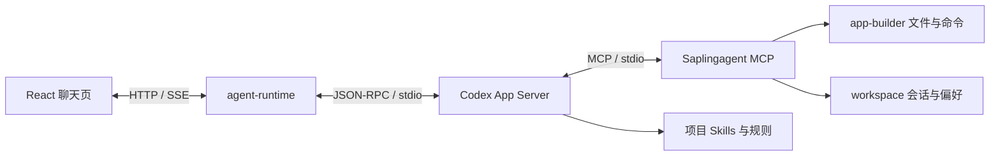

<h1 align="center">Saplingagent</h1>

<p align="center">
  
</p>

<h3 align="center">从一句想法，到自己的应用。</h3>

<p align="center">
  在本地，与 AI 一起构建持续生长的软件。<br>
  从一个聊天页面开始，塑造界面、添加能力，把代码留在自己的项目里。
</p>

<p align="center">
  <a href="README.md">English</a> · <strong>简体中文</strong>
</p>

<p align="center">
  <a href="#demo"><strong>▶ 中文演示 · 1:41</strong></a> &nbsp;·&nbsp;
  <a href="#quick-start">开始使用</a> &nbsp;·&nbsp;
  <a href="docs/index.html">使用文档</a>
</p>

<p align="center"><sub>macOS 13.5+ · Windows 10/11 x64 / ARM64 · 源码可用于许可证允许的非商业用途</sub></p>

<a id="demo"></a>

https://github.com/user-attachments/assets/06893877-3172-4147-8d6c-b88137347074

<p align="center"><sub>中文配音 · 大字号字幕 · 1 分 41 秒 · <a href="https://github.com/extendmachine/Saplingagent/releases/download/demo-2026-10-14/Saplingagent-Chinese-Demo-Final.mp4">下载高清原片</a></sub></p>

---

- **用对话构建。** 将需求变成 React 界面与本地应用功能。
- **让项目属于你。** 代码、对话与版本记录随应用保留。
- **按需扩展能力。** 连接 Codex、OpenCode 或 Claude Agent，使用 MCP 工具与 Skills。

看一个需求如何变成可用的时钟，再保存为新版本。中文配音 · 大字号字幕 · 1 分 41 秒。

<a id="document-workspace"></a>

## 应用案例 · WPS 风格的本地文档工作台

从一个聊天页面，生长出一套文档工作台。将文件浏览、Office 基础编辑、PDF 处理与 AI 对话放在同一个界面，让查阅、修改和保存更连贯。

这是使用 Saplingagent 构建的应用案例；默认安装仍从简洁的聊天页面开始。


| 功能模块 | 案例功能 |
| --- | --- |
| 文件浏览与管理 | 树形目录、文件名筛选、刷新列表、新建文件和文件夹、复制绝对路径。 |
| Word 文档 | 预览 DOCX，直接修改段落文字，调整整段字体、字号、粗体、颜色和对齐方式。 |
| 电子表格 | 查看 Excel、CSV、ODS 等文件，切换工作表，修改单元格内容及公式文本。 |
| PowerPoint | 按页查看 PPTX，通过文本面板修改幻灯片文字。 |
| PDF 查阅与编辑 | 翻页、缩放、修改或添加文字、填写文本表单、旋转与调整页面顺序、删除页面。 |
| 本地 OCR | 识别英文、简体中文页面，选中识别出的文字进行修改。 |
| PDF 图形处理 | 替换、裁剪和调整图片；修改矢量对象的位置、颜色及路径。 |
| Markdown 与代码 | Markdown 编辑和预览切换；常见代码、配置及文本文件编辑。 |
| 图片与影音 | 图片预览、音频播放、视频播放。 |
| 保存与恢复 | 保存前检查文件是否被外部修改，提示未保存内容，并支持恢复最近一次保存前的版本。 |

**Word 编辑**：在文档正文中直接修改段落，并使用格式工具栏。


**PDF 与 OCR**：本地中文识别后，选中文字进入编辑面板。


<details>
<summary>查看编辑范围</summary>

Office 支持基础编辑：Word 格式作用于整段，PowerPoint 以文字修改为主，不包含对象或动画编辑。表格显示前 250 行、60 列，可修改公式文本，但没有公式计算引擎。PDF 修改可能改变字体或影响重叠对象。文件面板目前提供浏览和新建，尚未实现重命名、移动和回收站管理。

</details>

<a id="ai-farmer"></a>

<p align="center">
  
</p>

<p align="center"><strong>让我们做新时代的AI农民</strong></p>

<details>
<summary>查看完整指南</summary>


- [安装、配置与启动](#quick-start)
- [无 Git 的应用文件夹与内核升级](#storage)
- [切换版本与重启](#restart)
- [更新与依赖修复](#updates)
- [导入已有的本地凭据](#credentials)
- [模型认证与费用](#authentication)
- [OpenCode 与 Claude Agent](#engines)
- [模型、权限与配置](#configuration)
- [常见问题](#troubleshooting)
- [应用结构与开发方式](#structure)
- [分支与源码交付](#delivery)
- [许可证与参考资料](#license)

</details>

<a id="quick-start"></a>

## 0.9.5：网页配置、本机启动器与内核归并

当前源码版本为 **内核 0.9.5**。请通过下方一行安装命令或 release 分支下载本版本。

右侧聊天支持历史会话切换与改名、各会话独立草稿、附件、GFM 表格和数学公式。收起面板后可拖动聊天入口，并记住位置。上下文条显示 Codex 最近报告的 token 数量和上下文容量；没有报告时显示未知。它不是费用统计，也不承诺自动压缩阈值。这些组件属于用户可编辑的应用部分，独立于内核升级。

1. 运行 `bash Saplingagent.sh`，检测设备、安装最小管理内核后直接打开配置网页。
2. 在网页修改项目名称、目标文件夹名称和图标，先点击“保存项目设置”；这一步只保存，不移动目录。再完成 AI 账号或接口配置并保存。
3. 每次打开配置时，项目内短进程 A 会准备完整的配置包（前后端和独立 Node）、复制到项目旁可见的同级临时目录（../sapling-config-*），启动外部 B 后退出。网页保存到项目内，凭据不复制到临时包。
4. 完成所有修改后，点击“保存并构建应用”。外部 B 停止本项目服务、等待进程退出，再应用文件夹名称并编译“项目名称.app”（Mac）或“项目名称.exe”（Windows）。页面地址保持不变；不会覆盖同名目录。构建失败会保留当前实际目录和配置，修复后重试。
5. 构建完成后点击“完成配置”。B 启动项目内 A 并交接临时目录，随后退出；A 等待 B 退出，再清理自己的临时配置包。之后双击应用，启动器检查并安装缺少或变更的依赖，再打开项目。更改名称、图标或 AI 时重新打开配置；重新构建成功后替换上次产物，失败保留原产物。

点击 `.app` 或 `.exe` 后，启动器显示准备进度，并在服务管理器可用后打开 **Project status** 页面。页面显示项目名称、内核版本、实际目录和服务端口；通过 **Open app** 进入应用，通过 **Restart app / Stop app / Open logs** 重启、停止或查看本地日志。端口来自当前实例，未固定为 5173；断开连接不等于确认服务已停止。详见[项目状态说明](docs/project-status.html)。

macOS 上，应用会作为普通应用留在 Dock。点击 Dock 图标可重新打开项目状态；选择“退出”或按 **Command-Q** 会停止该项目的后台并退出应用。两个系统都可以使用状态页的 **Stop app**，等待服务确认退出后，再次打开原生应用即可重新启动。单独关闭浏览器或隐藏启动进度不会停止服务。停止失败时可查看 `logs/project-launcher/` 后重试。配置流程会等待原生应用和启动辅助进程退出后再改名或替换启动器。已有安装更新源码后，请通过“保存并构建应用”重新构建旧 `.app` / `.exe`，以启用新的进度显示；应用源码和服务集群保持不变。

通过 `bash Saplingagent.sh configure --no-open` 可重新打开管理；`SAPLING_LEGACY_MENU=1 bash Saplingagent.sh` 保留旧终端菜单。原生 Windows 图标、目录改名和替换需要真机验收。详见[启动器说明](docs/project-launcher.html)。旧终端菜单仅作为显式选择的兼容入口。

## 安装、配置与启动

### 1. 获取完整应用

在 **macOS 终端**或 **Windows Git Bash** 中运行以下命令，即可下载并安装，随后打开中文配置网页。Windows 请先安装 [Git for Windows](https://gitforwindows.org/)。

```bash
bash -o pipefail -c 'curl -fsSL https://raw.githubusercontent.com/extendmachine/Saplingagent/release/install.sh | bash -s -- --lang zh'
```

独立的 `install.sh` 会解析当前 **release** 提交，下载该提交对应的完整源码到 `./Saplingagent`，安装最小管理内核，再打开项目与 AI 配置网页。下载阶段不要求预装 Node，也不会克隆作者的全部分支。完成项目名称、图标和 AI 配置后，在网页编译启动器。

目标文件夹必须是新目录。使用 `--dir` 指定另一个位置：

```bash
bash -o pipefail -c 'curl -fsSL https://raw.githubusercontent.com/extendmachine/Saplingagent/release/install.sh | bash -s -- --dir "./My Saplingagent" --lang zh'
```

已有应用请使用原文件夹中的内核管理或显式修复命令，不要用新建目录安装命令覆盖它。`--download-only` 仅下载源码；随后进入下载目录，运行 `bash Saplingagent.sh`。第一次安装会初始化接收者自己的目标与任务记录；安装前已有的修改会保留并给出提示。

下载需要访问 GitHub API 与源码归档服务，并使用 curl、tar 和 SHA256 工具；macOS 和 Git Bash 提供这些工具。遇到网络、限流或下载错误时，按终端提示处理；若源码已经下载成功而后续安装失败，请在现有应用目录重试安装。

也可以手动获取源码：

```bash
git clone --single-branch --branch release --no-tags https://github.com/extendmachine/Saplingagent.git
cd Saplingagent
```

或者[下载 release 源码 ZIP](https://github.com/extendmachine/Saplingagent/archive/refs/heads/release.zip)并解压。默认交付分支是 `release`；如需其他版本，请明确选择。私有仓库需要相应访问权限。

### 2. 通过统一入口安装

进入完整应用文件夹，运行：

```bash
bash Saplingagent.sh --lang zh
```

- **macOS：**使用终端，支持 Apple Silicon 和 Intel。
- **Windows：**在项目目录中使用 Git Bash，支持 Windows 10 1809+ / Windows 11 的 x64 与 ARM64。CMD 或 PowerShell 不能直接执行 Bash 脚本；WSL/Linux 不属于此原生 Windows 安装路径。

直接运行 `bash Saplingagent.sh` 时，首先选择 English 或 中文，回车默认 English。不要用 `sh` 执行，也不以双击脚本作为标准启动方式。

脚本安装最小管理内核后，直接打开配置网页；按上方内核0.9.5流程保存名称、图标和 AI 配置，再保存并构建应用、完成配置。日常双击生成的启动器，检查并安装缺少或变更的依赖后启动项目；更改设置时重新打开配置。

如需旧版终端菜单，运行 `SAPLING_LEGACY_MENU=1 bash Saplingagent.sh --lang zh`。显式恢复命令仍可使用 `configure --no-open`、`install --repair`、`start`、`doctor` 和 `kernel`。

安装程序将固定版本的 Node **24.21.0**、Codex **0.146.1**、OpenCode、Claude Agent SDK **0.3.296** 和锁定依赖安装到项目内，并核对官方 Node SHA-256。无需预装 Node、npm、Homebrew 或 Codex 桌面应用，也无需 sudo 或全局 npm 安装。版本声明见 [kernel/config/macos.json](kernel/config/macos.json) 和各模块的锁文件。

新安装不需要配置 Git；Windows 由 Git for Windows 提供 Git Bash。安装需要访问官方下载、npm 与所选模型服务。`.runtime/` 保存运行时，各模块 `node_modules/` 保存依赖，`.cache/npm/` 保存 npm 缓存。请保留整个应用文件夹。

### 3. 配置 AI，开始第一次对话

**配置 AI**在安装完成后打开独立的本地网页，不要求先启动聊天服务。页面支持中英文：

| 方式 | 配置内容 |
| --- | --- |
| ChatGPT 账号 | 使用官方 Codex 登录页面或设备码；也可以选择已有的项目本地登录。完成后可作为默认方案 |
| Codex API | 填写方案名称、API Base URL、API key 和准确模型 ID；自定义端点需要支持 Responses |
| OpenCode API | 支持 Chat Completions、Responses 或 Anthropic Messages，按服务商协议选择 |
| Claude Agent API | 使用 Anthropic Messages 协议、你自己的 API key 和准确模型 ID |

填写 **API 地址**，不要填写网站首页。预设可辅助配置 OpenAI、OpenRouter、Anthropic 或本地 Ollama 兼容端点。需要其他协议、任意自定义请求头或独立订阅 OAuth 的服务商，仍需对应适配。

**获取模型 / Fetch models**是可选的目录查询；不支持查询时可手动填写模型 ID。用于应用开发的模型应支持流式输出与工具调用。保存方案不代表已验证模型兼容性或可用额度。

点击 **保存并使用 / Save & use**，完成所有修改后选择 **保存并构建应用 / Save & build app**。等待构建完成，再点击 **完成配置 / Finish setup**，随后双击项目内 App。可以保存多个方案并切换默认项；更换服务商后新建对话。**完成配置 / Finish setup** 会交回项目内启动器，等待外部配置进程退出后清理临时目录，单独关闭浏览器标签不会停止服务。浏览器未自动打开时，使用终端打印的本地网址。

方案元数据保存在 `local-secrets/ai-config/connections.json`，API key 保存在 `local-secrets/api-keys/`，Codex 登录凭据保存在 `local-secrets/codex/`。凭据总账只保存文件引用。页面不会将已有密钥回填到表单；编辑时留空可保留旧密钥。安装不会自动导入全局凭据。

OpenCode 独立方案和自定义 Codex API 方案无需先登录 ChatGPT。修改默认方案后，重启应用并新建对话；已有对话保留原来的引擎与模型，不要将旧 Codex 会话交给另一服务商恢复。详见 [AI 配置指南](docs/ai-configuration.html)和[配置服务契约](kernel/services/ai-config/CONTRACT.md)。

启动后使用终端打印的**实际网址**。默认从端口 `5173` 开始，已被占用时自动向上选择空闲端口。发送一条消息，检查真实回复；安装成功、已登录和获取到模型列表都不等于推理成功。

### 命令行操作

统一入口也支持显式命令，适合自动化或故障恢复：

```bash
bash Saplingagent.sh install --repair
bash Saplingagent.sh configure
bash Saplingagent.sh configure --no-open
bash Saplingagent.sh login --device-auth
bash Saplingagent.sh opencode
bash Saplingagent.sh start --no-open
bash Saplingagent.sh doctor
bash Saplingagent.sh git
bash Saplingagent.sh kernel
bash Saplingagent.sh logout
```

设备码登录取决于账号与组织的实际资格。`bash Saplingagent.sh` 不要求修改可执行位；保留可执行位时也可运行 `./Saplingagent.sh`。

<a id="storage"></a>

## 无 Git 的应用文件夹

内核0.9.5 下载的是 release 源码快照，不包含 `.git`，安装时不创建 Git、不询问存放方式、不连接作者仓库。默认网页不再显示分支、Git 版本和 Save version。以后可自行创建仓库；重新安装或升级内核不会删除已有 Git、应用源码、数据和配置。

## 独立内核升级

网页右上角 **Kernel → Check for kernel update → Upgrade kernel & restart**。升级器固定 release 提交并校验清单，显示变更和冲突，再停止当前应用、备份和替换内核、修复内核自己的依赖、完整重启并跳转到实际端口。页面、聊天、MCP、Skills、自定义业务和应用依赖声明保留。独立进度网页在原服务停止后继续工作，失败时可重试或手动恢复；不自动回退。

当前内核版本为 **0.9.5 / schema3**；release 分支同步本版本；GitHub Releases 的旧标签和附件另行管理。0.9.1 的 schema2 原型不能直接跨边界升级：请下载0.9.2到新目录，保留原目录，再人工迁移自己的应用/数据/配置；不要覆盖真实凭据或重新生成旧目录基线。之后同 schema3 内核可在网页升级。完整说明：[内核管理](docs/kernel-management.html)。


## 导入已有的本地凭据

在 **配置 AI → ChatGPT 账号**选择 **Use local Codex login**或 **Upload auth.json**。本地文件来自调用者的 `CODEX_HOME`，否则使用 `~/.codex/auth.json`；Windows 对应 `%USERPROFILE%\.codex\auth.json`。所选登录复制到此应用的 `local-secrets/codex/auth.json` 并启用；已有项目账号需要显式勾选 **Replace existing credentials**才会替换。只有系统钥匙串或桌面端登录时，可能没有可导入的文件，此时使用官方登录按钮。不会修改全局登录或配置。

Claude 使用 **Claude API**，填写服务地址与模型，再选择 **Import local Claude API credentials**或 **Upload API credential JSON**。本地导入读取启动终端继承的 `ANTHROPIC_API_KEY`，或 `CLAUDE_CONFIG_DIR` / `~/.claude/settings.json` 中的 API 环境字段。JSON 支持 `apiKey`、`ANTHROPIC_API_KEY`、`env.ANTHROPIC_API_KEY`，可附带 `baseUrl` / `model`；非空表单优先。替换已有方案密钥也需要明确选择。

导入不读取 Claude 订阅 OAuth 文件、系统钥匙串或可执行凭据助手。文件最大 32KiB，只发送给受保护的本地配置服务。密钥保存在 Git 忽略的项目文件中，不写入状态响应或浏览器存储。导入只验证本地结构与保存，不验证有效期、额度或模型推理；保存并构建应用、完成配置后再打开 App；更换服务商后新建对话。详见 [AI 配置指南](docs/ai-configuration.html)。

<a id="authentication"></a>

## 模型认证与费用

本地 App Server 没有额外的独立服务器费用；模型调用需要**你自己的认证与可用额度**。Saplingagent 不提供开发者账号、共享 API key 或免费模型承诺。

| 方式 | 认证与计费 |
| --- | --- |
| ChatGPT 账号方案 | 通过官方 Codex 使用自己的账号；可用模型与限额取决于套餐、组织及账号资格 |
| Codex / OpenCode / Claude Agent API 方案 | 使用自己的服务商凭据和兼容端点，按服务商规则计费；API 费用与 ChatGPT 订阅分开 |

安装、保存登录和模型目录查询与推理成功是不同步骤。启动和诊断不会自动发送模型提示词；发送聊天消息才开始模型调用，重装不会增加额度。当前条件请查看 [Codex 认证](https://learn.chatgpt.com/docs/auth)与[使用限制及计费](https://learn.chatgpt.com/docs/pricing)。

**商业与托管认证：**OpenAI 对已有本地或开源应用的 App Server 登录提供延续说明，并建议迁移到 Sign in with ChatGPT；其文档说明 App Server 认证不允许用于商业或托管服务。本项目尚未完成商业 Sign in with ChatGPT 注册与集成。Saplingagent 商业许可不等于 OpenAI 认证授权，两者需要分别解决。参见 [App Server 认证说明](https://learn.chatgpt.com/docs/app-server)和 [Sign in with ChatGPT 集成](https://developers.openai.com/siwc/token-sharing-open-source/codex-app-server)。

<a id="engines"></a>

## OpenCode 与 Claude Agent

没有保存方案时，Codex 是初始默认引擎。在 **配置 AI → API / 自定义服务商**选择 OpenCode，可使用 Anthropic、OpenRouter 或兼容端点，并将方案设为默认。需要原生服务商选择器时，用 `bash Saplingagent.sh opencode` 作为显式终端恢复入口，凭据保存在 `local-secrets/opencode/`。

Claude Agent 通过官方 **Claude Agent SDK**作为独立的本地引擎运行，内嵌 Claude Code 的 Agent 循环，支持原生文件 / 命令工具、MCP、项目 Skills、流式输出和会话恢复；没有独立对外 App Server 端口，也不通过 Claude Desktop 执行推理。

安装后进入 **配置 AI → API / 自定义服务商 → Anthropic · Messages**，预设会选择 **Claude Agent**。填写自己的 API key、准确模型 ID，以及 `https://api.anthropic.com/v1` 或兼容网关地址。保存并使用，再保存并构建应用，完成配置后打开 App；更换服务商后新建对话。网关需支持 Anthropic Messages 流式输出与工具调用，模型发现可选，Claude 方案无需 Codex 登录。

SDK 固定为 `0.3.296`，原生二进制安装在应用文件夹内，无需全局安装 Claude Code。共享 API key 位于 `local-secrets/api-keys/`，Claude 状态和会话位于 `local-secrets/claude/`。项目 `CLAUDE.md` 引入 `AGENTS.md`，`.agents/` 作为本地 `saplingagent` 插件加载现有 Skills。

本项目提供客户自己的 API 方案，不提供或导入 claude.ai 订阅登录。第三方产品使用该认证需遵循 Anthropic 的事先批准要求；SDK 组件遵循其自身条款。参见 [SDK 概览](https://code.claude.com/docs/en/agent-sdk/overview)和[快速开始与认证](https://code.claude.com/docs/en/agent-sdk/quickstart)。

每个对话始终绑定最初的引擎与模型；切换请新建对话，不会自动回退、重发或静默替换丢失会话。Claude 原生问题对话框 / MCP elicitation 表单暂未渲染，Agent 通过普通聊天提问。本地启动只证明原生初始化及项目 MCP / Skills 可用；付费模型、第三方网关和原生 Windows 行为仍需实际验证。OpenCode 的 Anthropic 服务商可独立使用。

<a id="configuration"></a>

## 模型、权限与配置

公共设置位于 [config/runtime.json](config/runtime.json)：

| 设置 | 默认值 | 行为 |
| --- | --- | --- |
| 首选模型 | `gpt-6.1-sol` | 以实际 App Server 目录为准，不可用时选择其默认 / 首个模型 |
| 推理力度 | `medium` | 必须由实际模型支持 |
| 网关 / Vite / 管理器 / Agent / Workspace / Builder | `5173` / `5174` / `4314` / `4310` / `4311` / `4312` | 均为起始值，启动时选择空闲回环端口；可选 PDF 从 `4313`、OpenCode 从 `4315` 开始 |
| 权限模式 | `full-access` | Codex 使用 `danger-full-access`、`approvalPolicy: never`；Claude 使用 `bypassPermissions`并关闭沙箱 |
| 整轮超时 | `turnTimeoutMs: 0` | 默认关闭；显式非零值启用总时限 |
| 无进展提醒 | `turnIdleWarningMs: 600000` | 10 分钟无有效进展时提醒，不自动停止或重发 |

界面与状态显示**实际选中的模型**，目录中有某个模型不代表账号一定有权限。工具命令有独立超时，通常 60 秒，可明确配置到一小时。

Full Access 使用当前操作系统用户已有权限，可操作前后端、MCP、Skills、规则及文件 / 命令；不会获得 root，也不会绕过系统权限。没有项目目录白名单、强制编译 / 哈希门槛或自动回滚。保存的原件可能支持用户主动要求的恢复，但任意命令或原生写入不保证可撤销。

普通应用修改建议放在自己的应用文件夹内；客户明确要求时，可以操作当前用户有权限的外部代码。该建议不增加技术路径限制。每次最终 AI 回复（含只读交流）都要求按项目规范提供八字段完成复核回执，只读回复不写任务记录；实际模型遵循情况仍需对话验证。

前端修改通常由 Vite 热更新；后端、MCP、Skill 发现或依赖变化后请重启，让新进程加载对应代码。

### Codex App Server 如何连接

安装器和启动器负责集成，无需在 Codex 桌面应用手动添加 MCP，也无需维护远程 Saplingagent 服务器：



1. [kernel/scripts/macos/codex.sh](kernel/scripts/macos/codex.sh) 选择项目 Node / Codex，设置项目 `CODEX_HOME`，使用文件凭据。
2. [rpc.mjs](kernel/engines/rpc.mjs) 启动 `codex app-server --listen stdio://`，通过标准输入 / 输出交换按行分隔的 JSON。
3. [server.mjs](backend/agent-runtime/server.mjs) 完成 `initialize` / `initialized`、账号与模型查询、会话创建 / 恢复与 turn 调用，将文本和工具事件通过 SSE 发往浏览器。
4. `mcp_servers.seedagent` 启动[项目 MCP](backend/mcp-runtime/server.mjs)，提供 **15 个工具**，覆盖项目上下文、文件、命令、变更记录、偏好与 Skills。
5. [.agents/skills/](.agents/skills/) 提供 `seed-page-edit`、`seed-research`、`seed-skill-author`；规则入口是 `AGENTS.md → rules/README.md`。

不会替换全局 Codex 配置。现有 `seedagent`、`SEED_*`、`SEEDAGENT_*` 和 `seed-*` 标识保留协议与数据兼容性。需要 stdio 调试示例时，参见[英文 README 的连接说明](README.md#how-codex-app-server-connects)和[官方协议文档](https://learn.chatgpt.com/docs/app-server)。

<a id="troubleshooting"></a>

## 常见问题

优先使用菜单中的诊断，或执行 `bash Saplingagent.sh doctor`。诊断检查安装、版本、AI 方案与实际实例状态，不显示密钥，也不发模型提示词。

| 问题 | 处理方式 |
| --- | --- |
| 双击脚本打开编辑器 | 在项目目录的终端 / Git Bash 中运行 `bash Saplingagent.sh` |
| 提示缺少登录 | 配置对应账号或 API 方案；账号登录可运行 `bash Saplingagent.sh login` |
| 登录过期 / 更换账号 | 执行 `bash Saplingagent.sh logout` 后重新登录 |
| 下载或依赖失败 | 检查网络，再运行 `bash Saplingagent.sh install --repair` |
| 安装锁未清除 | 确认该项目安装器已退出，只移除本项目失效的 `.runtime/node-install.lock` / `.runtime/macos-install.lock` 后重试 |
| Windows 设备检测前以 150 退出 | 更新完整源码后在 Git Bash 重试；保留此前错误文字，退出码本身不能说明原因。交互操作会在可用时使用前台原生控制台桥接 |
| 默认端口被占用 | 使用启动器打印的实际网址；它会自动选择空闲端口。绑定竞争失败时重新启动，不要终止其他项目 |
| 120 秒内未就绪 | 运行诊断，检查启动终端和 `logs/<service>/` 元数据 |
| 本地服务连接失败 | 保留启动终端，检查诊断及 `.runtime/runtime-address.json` 中实际端口，必要时完整重启 |
| 会话不存在 | 界面保留未发送 / 重试输入，并创建新会话；不要为此删除 `data/` |
| 长时间无进展 | 检查工具或用户决定是否待处理，选择继续等待或手动停止；提醒不会自动设置整轮截止时间 |
| OpenCode 将内部权限指令当作回复 | 更新到包含消息归属修复的版本，重启后端 / 应用并新建对话；保留数据与凭据。核对实际分支，release 可能落后于 main |
| 模型权限或额度报错 | 查看真实账号错误与服务商限制；重装不会授予权限或额度 |

移动应用前先停止服务，并移动**整个文件夹**。相同架构下启动器会解析新位置；更换系统、架构或锁文件后需要重装对应依赖。原生 Windows 登录、模型、MCP、重启和 ARM 硬件行为尚需真实设备验收。

<a id="structure"></a>

## 应用结构与开发方式

```text
Saplingagent/
├── README.md / README.zh-CN.md # 英文 / 中文项目说明
├── Saplingagent.sh             # macOS / Windows 中英文统一菜单
├── front/                     # React 聊天与应用功能
├── backend/
│   ├── agent-runtime/         # 模型引擎、对话、SSE 与 Git API
│   ├── ai-config/             # 独立账号 / API 配置
│   ├── runtime-manager/       # 运行管理、网关与重启
│   ├── workspace/             # 本地会话、偏好与证据
│   ├── app-builder/           # 文件 / 命令与可选恢复
│   └── mcp-runtime/           # MCP stdio 工具
├── .agents/skills/            # 项目工作流
├── contracts/                 # 公共服务契约
├── config/ / scripts/         # 配置、安装、运行与打包
├── rules/ / docs/             # AI 规范与 HTML 使用说明
├── LICENSE / NOTICE / THIRD_PARTY_NOTICES.md
├── local-secrets/             # 凭据，Git 忽略
├── .runtime/                  # 本地运行时，Git 忽略
├── data/ / snapshots/ / logs/  # 私有运行内容，Git 忽略
└── AGENTS.md / FINAL_GOAL.md / TODO.md / AI_TASKS.md
```

保留完整应用文件夹：源码、配置、规则、Skills 与辅助脚本都随项目交付，依赖安装在项目内，模型服务仍是声明的外部依赖。不要仅复制一个启动脚本，也不要依赖开发者的其他仓库、固定路径或外部源码软链接。

新下载包不包含 Git，安装不初始化仓库、不连接远端、不合并应用源码。旧 Git 模块保留为可选应用代码，默认页面不挂载。重新安装或内核维护保留用户自行创建的仓库和应用文件。

AI 开发先读 [AGENTS.md](AGENTS.md)和 [rules/README.md](rules/README.md)。各服务维护 `SERVICE.md`、`CONTRACT.md`、`DEPLOY.md`、`REFERENCES.md`，人类使用指南在 `docs/`。现有用户对话不因菜单或文档翻译而改变。

<a id="delivery"></a>

## 分支与源码交付

| 分支 | 用途 |
| --- | --- |
| `main` | 维护者的开发与测试 |
| `adobe-replica` | Adobe 复刻实验 |
| `release` | 对外默认首页、源码交付与演示展示 |

新用户默认安装 `release`，它可能落后于 `main`。共享修改先进入 main 并验证，再按发布要求同步到 release；明确要求仅修改 main 时，release 保持不动。视频、展示案例及配图只维护在 release；同步代码时保留这些内容，不用 main 的整个目录覆盖 release。实验分支仅在明确要求时同步，历史保留。

维护者打包 Mac 源码时，使用项目安装的 Node：

```bash
SEED_NODE_VERSION="$(/usr/bin/plutil -extract nodeVersion raw -o - kernel/config/macos.json)"
SEED_ARCH="$(/usr/bin/uname -m)"
if [ "$SEED_ARCH" = "x86_64" ]; then SEED_ARCH=x64; fi
".runtime/node-v${SEED_NODE_VERSION}-darwin-${SEED_ARCH}/bin/node" kernel/scripts/package-macos.mjs release
```

Windows 源码包使用 `<project-node> kernel/scripts/package-windows.mjs release .cache/releases`，其中 `<project-node>` 代表此项目安装的 Node 路径。

包和 `.sha256` 位于 `.cache/releases/`，包含已提交源码、完整规则 / Skills、许可证、锁文件，以及 `delivery.json` 的逐文件 SHA-256 清单。接收者记录重新初始化，不继承维护者历史与批准。默认不包含凭据、对话、日志、快照、依赖目录、运行时与 Git 元数据。

**不要直接压缩正在运行的项目文件夹分发。**使用项目打包器。GitHub ZIP 是源码快照；客户打包器还初始化接收者记录。打包默认使用已提交的 `release`，不会静默改用 `main` 或 `HEAD`；明确指定其他 ref 时会记录真实分支 / 提交。打包不等于发布 GitHub Release。参见[交付检查清单](docs/release-checklist.html)。

<a id="license"></a>

## 许可证与参考资料

Saplingagent 是独立软件，并非 OpenAI 官方产品。商业使用需另行取得书面许可，第三方认证须分别遵守其条款，参见 [NOTICE](NOTICE)。

项目自有源码使用 **[PolyForm Noncommercial 1.0.0](LICENSE)**，允许许可证规定的非商业使用、修改与分发，需遵守声明保留等条款。商业用途需与所有者另行达成书面许可，可通过 [extendmachine](https://github.com/extendmachine) 联系。这是源码可用许可证，不是无限制的商业开源授权。准确范围以 [LICENSE](LICENSE)及[官方条款](https://polyformproject.org/licenses/noncommercial/1.0.0)为准。

依赖和第三方材料保留其自身许可，见 [THIRD_PARTY_NOTICES.md](THIRD_PARTY_NOTICES.md)；本项目的限制不重新许可这些材料，也不据此主张拥有用户生成的应用。

Codex 认证、使用限制和 App Server 说明于 **2026-10-14**重新核对。本文版本号描述本仓库固定安装版本，不代表上游最新版本；账号资格、价格与第三方条款以官方当前说明为准。

- [Codex App Server](https://learn.chatgpt.com/docs/app-server)
- [Codex 认证](https://learn.chatgpt.com/docs/auth)
- [Codex 使用限制与计费](https://learn.chatgpt.com/docs/pricing)
- [Sign in with ChatGPT / App Server](https://developers.openai.com/siwc/token-sharing-open-source/codex-app-server)
- [本地文档首页](docs/index.html) · [中文 macOS 安装](docs/macos-install.zh.html) · [中文 Windows 安装](docs/windows-install.zh.html)
- [AI 配置](docs/ai-configuration.html) · [Git 版本管理](docs/git-versions.html) · [服务接口](docs/api-interfaces.html)

项目规则随 `rules/` 交付。本文翻译不改变授权、凭据处理、任务协调或 Full Access。只有明确要求向其他项目引入规范时，才使用[规范分发指南](rules/DISTRIBUTION.md)；正常安装不依赖开发者的规范源文件夹。

Windows 内部借助系统 PowerShell 做检测 / 下载 / 解压，但用户仍使用 Git Bash 的同一入口，不要求独立 `.ps1`、全局 Node / Codex、注册表 / 全局 PATH 或永久执行策略修改。启动器自动选择 Mac Intel / Apple Silicon、Windows x64 / ARM64；Linux、WSL 和 32 位设备在下载前被拒绝。强制关闭终端、断电或另行脱离的程序不保证能清理；运行命令的副作用不会被自动撤销。更多平台实现与调试细节见 [English README](README.md#windows-operation-and-delivery)。

## 文件对话与页面读取

点击回形针、拖入文件或粘贴图片，即可随消息发送。附件保存在本地项目，已发送附件可随会话恢复（单文件20MiB、每条消息10个）。界面修改后，AI 可通过 page_read 读取当前打开页面的新 DOM、布局及可用的渲染图像，无需额外申请项目文件夹或录屏权限；页面未打开、图像不可用时会明确报告。[使用说明与限制](docs/runtime.html#chat-files-pages)。

## 发布版本识别

当前统一称为 **内核版本 0.9.5**，唯一依据为 `kernel/manifest.json`，不再区分产品版本。页面、配置、安装和更新均读取内核版本；数据不可用时如实显示不可用。旧 `config/release.json` 与 `releaseVersion` 字段仅为兼容别名，不作为运行时版本依据。

源码 ZIP 的 `delivery.json` 同时记录 `releaseVersion` 和精确的 `sourceCommit`，文件名也包含二者。本次将0.9.5同步到 release 分支供验收，不移动旧标签或上传 GitHub Release 附件；下载本版本请使用 release 分支源码或一行安装命令。后续发布时，标签、发布页面、产品声明和下载回执必须对应同一份已核对源码；不得自行递增用户指定的版本号。维护者先核对并冻结代码，再核对版本声明、release 提交、不可移动的标签及下载包校验值。参见[发布检查表](docs/release-checklist.html)和[实际发布记录](https://github.com/extendmachine/Saplingagent/releases)；源码标签、GitHub Release、真机和真实模型验收分别记录。

## 旧内核编号的一次性升级

旧0.90/0.91/0.92更新器会把0.9.4误判为降级。需要在原应用的 .cache 内下载新版工具，用新版 CLI 的 --root 明确指向原应用再检查、更新。保留原始基线，仍需停止应用并处理冲突、备份和风险确认。不要整包覆盖业务文件或重新生成客户基线。操作说明：[内核版本迁移](docs/kernel-version-migration.html)。
